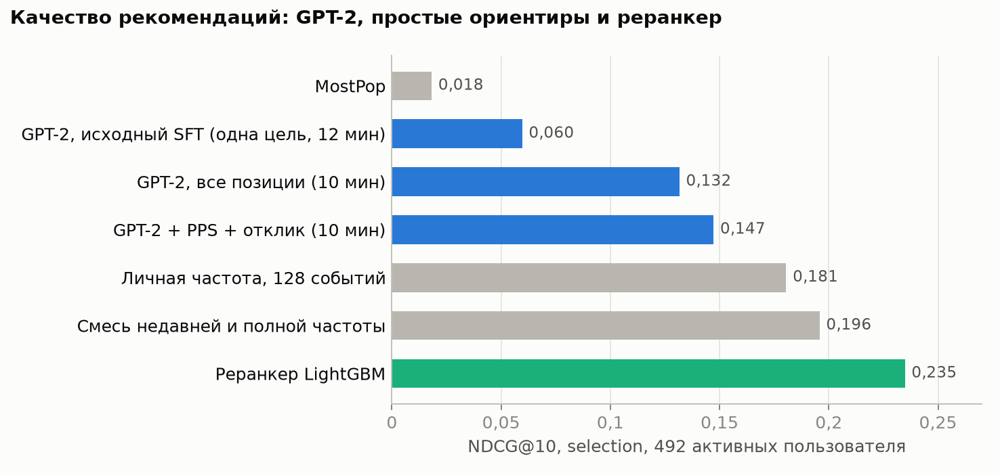
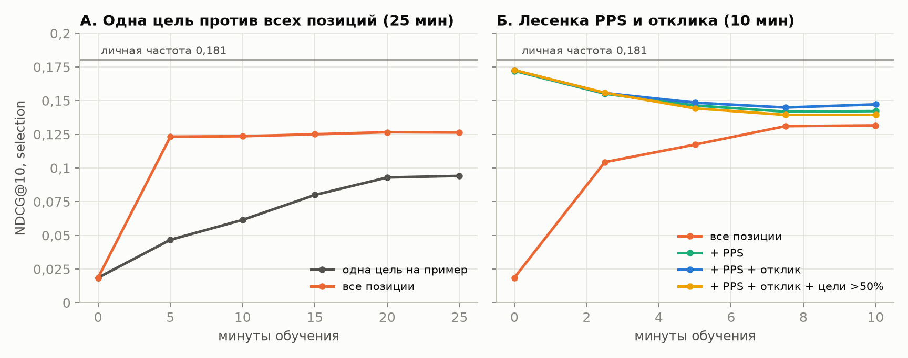
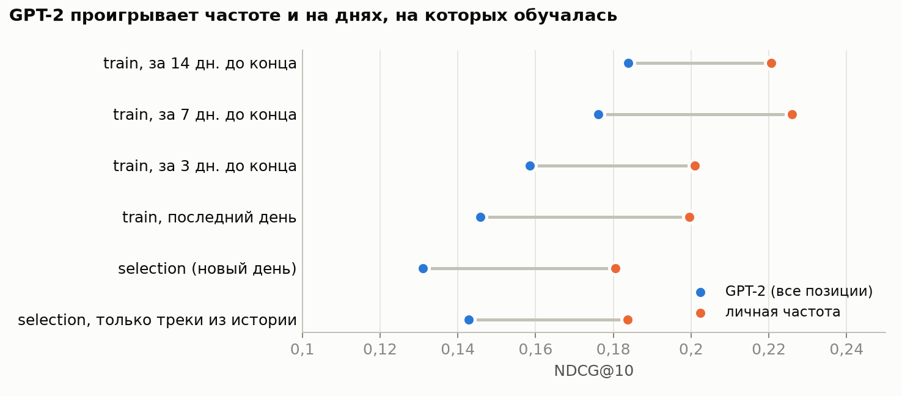
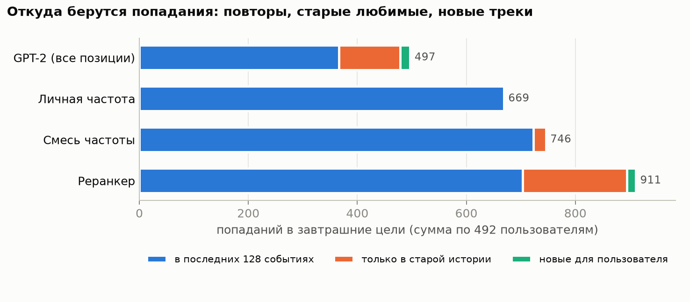
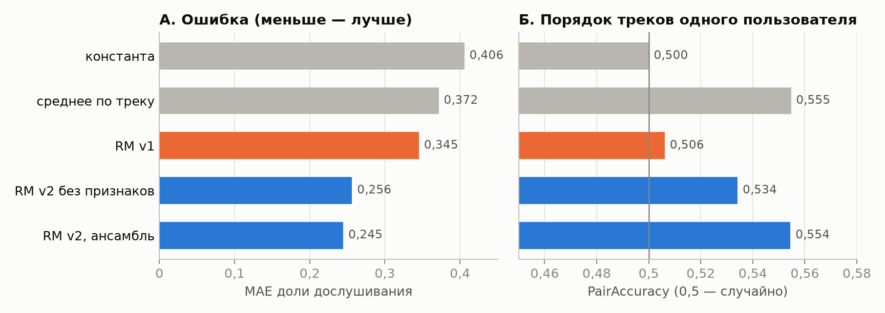
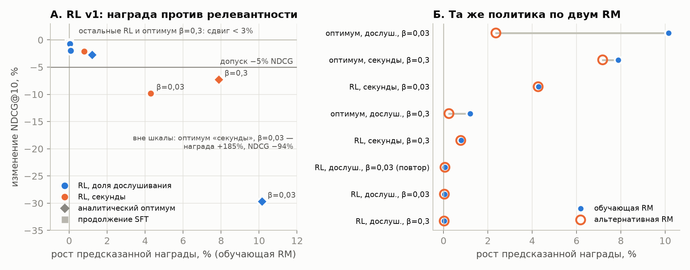
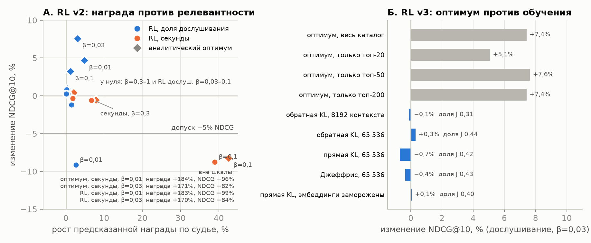
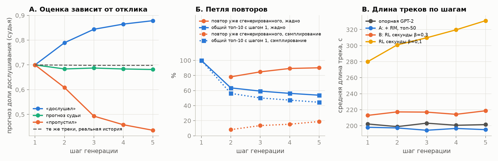
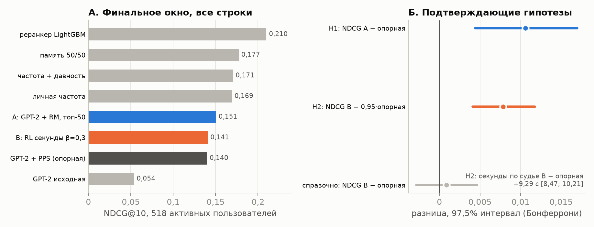

# RL-дообучение GPT-2 для музыкальных рекомендаций

## Аннотация

В работе исследуется, как обучение по прогнозу модели награды меняет музыкальные рекомендации. На Yambda обучены GPT-2 для предсказания следующего трека и модель доли дослушивания. Затем сравниваются RL-дообучение, продолжение обычного обучения и перевзвешивание кандидатов по награде при выдаче. Проверяются релевантность, длина и разнообразие выдачи, а также генерация пяти треков подряд.

Рост предсказанной награды не всегда сопровождается ростом релевантности. При большом весе награды «секунды» политика выбирает длинные незнакомые треки и резко теряет NDCG. При более сильной KL-регуляризации на финальном окне подтверждён прирост 9,3 предсказанной секунды с сохранением NDCG в пределах заранее заданного допуска 5%. Перевзвешивание 50 кандидатов по прогнозу дослушивания повышает NDCG с 0,1399 до 0,1505. Небольшая обученная голова с признаками пары «пользователь–трек» также улучшает ранжирование; её прирост подтверждён на другой группе пользователей и повторён в другой день. Когда веса GPT-2 обучаются по награде вместе с такой головой, NDCG тоже растёт (около +7–9% к исходной модели на трёх seed, исследовательский опыт). Голова над замороженной GPT-2 даёт столько же или чуть больше, поэтому отдельный вклад обучения весов GPT-2 поверх головы не установлен. При этом частотные методы и LightGBM-реранкер остаются сильнее всех проверенных вариантов GPT-2.

Оценка выполнена офлайн. Финальный тест и проверка на новых пользователях относятся к одному календарному дню; повтор на тех же новых пользователях в другой день (окно confirmation, N3) воспроизвёл оба эффекта. Рост прогнозируемых секунд не означает доказанного роста реального времени прослушивания. Причина, по которой обучение весов GPT-2 без признаков пары не воспроизводит эффект перевзвешивания, отдельно не установлена; наиболее вероятное объяснение (выход политики не видит пару пользователь–трек) остаётся гипотезой.

Разделы 1–3 описывают данные и модели, 4–8 — эксперименты и диагностику, 9 — заранее зафиксированные проверки, 10–12 — связь с литературой, ограничения и дальнейшую работу. Порядок запуска приведён в [REPRODUCE.md](REPRODUCE.md), термины — в [глоссарии](../docs/GLOSSARY.md).

### Итог в одной таблице

NDCG@10 на трёх нетронутых проверках; прочерк — метод там не оценивался. Подробности и интервалы — в разделе 9. Столбцы — разные окна и пользователи: сравнивать методы можно только внутри столбца; числа совместного обучения относятся к selection и с ними не сопоставимы.

| Метод | Финальное окно | Новые пользователи, тот же день | Новые пользователи, другой день (N3) | Статус |
|---|---:|---:|---:|---|
| Опорная GPT-2 (next-item + PPS) | 0,1399 | 0,1140 | 0,1343 | исходная модель |
| B: RL «секунды», β = 0,3 | 0,1408 | 0,118 | 0,1356 | H2 подтверждена: +9,3 предсказанной секунды, NDCG в допуске 5% |
| A: перевзвешивание топ-50 по модели награды | 0,1505 | 0,1231 | 0,1485 | H1, N1, N3a подтверждены |
| Голова с признаками пары над замороженной GPT-2 | — | 0,1287 | 0,1513 | N2, N3b подтверждены |
| Совместное RL-обучение весов GPT-2 и головы | — | — | — | только selection: 0,1575–0,1603 против 0,1473 у опорной, исследовательский |
| Личная частота (последние 128 событий) | 0,1693 | 0,158 | 0,1687 | простой ориентир |
| LightGBM-реранкер | 0,2099 | 0,203 | 0,2172 | сильнейший ориентир |

### Что подтверждено, что описательно, что остаётся гипотезой

| Утверждение | Статус | Раздел |
|---|---|:-:|
| H1: перевзвешивание топ-50 по RM (A) повышает NDCG@10 на финальном окне (+0,0106) | подтверждена, заранее зафиксирована, 97,5% | 9 |
| H2: RL «секунды» (B) поднимает прогноз секунд судьи на 9,3 с при NDCG в допуске 5% | подтверждена; прогноз модели, не наблюдённый исход | 9 |
| N1, N2: A и голова с попарными признаками лучше опорной на 1000 новых пользователях | подтверждены, заранее зафиксированы | 9 |
| N3a, N3b: то же на тех же новых пользователях в другой день | воспроизведены, заранее зафиксированы | 9 |
| Все шесть подтверждающих гипотез вместе (Бонферрони m = 6, 99,17%) | нижние границы всех интервалов выше нуля (пересчёт по сохранённым строкам) | 9 |
| Знаки выводов про A и B подтверждает судья другой природы (LightGBM) | описательно: selection | 9 |
| Сигнал модели награды лежит в признаках пары (RM без них не помогает) | описательно: selection, один seed RM | 5 |
| Совместное обучение весов GPT-2 и головы: NDCG +7–9% к исходной модели | описательно: selection, три seed | 5 |
| Обучение весов GPT-2 добавляет что-то поверх головы | не установлено: голова над замороженной политикой точечно не хуже | 5 |
| RL на квантильной награде: награда +7% при β = 0,3 без потери NDCG | описательно: selection, три seed | 6 |
| По реальным логам B даёт +3% прослушанных секунд, A — больше прослушиваний | описательно: selection, один день | 9 |
| Причина, по которой RL весов без признаков пары не работает (выход политики не видит пару) | гипотеза, согласуется с опытами, не доказана | 5 |
| Польза для слушателей | не проверена: нет online A/B | 11 |

### Где в отчёте ответы на вопросы задания

| Вопрос задания | Короткий ответ | Раздел |
|---|---|---|
| Базовая GPT-2 на next-item | Обучена на ID треков; на selection NDCG@10 0,1473 против 0,1805 у личной частоты, то есть проигрывает простому ориентиру | 2 |
| Модель награды и её качество на отложенной выборке | Доля дослушивания; v2 точнее v1 (macro MAE −0,071), MAE ансамбля 0,245 против 0,372 у среднего по треку, но внутри пользователя порядок не лучше среднего по треку (PairAccuracy 0,554 против 0,555) | 3 |
| Как меняется поведение после RL, удаётся ли максимизировать награду | При малом β награда растёт, но выдача уходит к длинным незнакомым трекам и схлопывается (RL «секунды» β = 0,01: 427 уникальных треков вместо 6658); при большом β сдвиг мал | 4, 5 |
| Сохраняется ли релевантность, не рекомендуется ли всем одно и то же | Зависит от β: при малом β NDCG падает и выдача сужается; при β = 0,3 на финальном окне потеря NDCG в пределах заранее заданного допуска 5% | 5, 9 |
| Долгосрочные цели | Долгосрочная награда по логам — «продолжение сессии»; «квантиль дослушивания» — отдельная награда за прослушивание с нормировкой по длине, не показатель удержания; RM продолжения упорядочивает хуже среднего по треку (0,471 против 0,515), RL на ней почти не сдвигает политику; RL на квантильной награде при β = 0,3 поднимает её на 7–8% без потери NDCG; возврат на следующий день не реализован, его проверяемая постановка (метка, цензурирование, базовая активность, граница выводов) описана; что проверяется офлайн, а что только онлайн — таблица в разделе | 6 |
| Генерация нескольких шагов вперёд | Оценка награды сильно зависит от предполагаемого отклика на сгенерированный трек (шаг 5: 0,879 при «дослушал», 0,436 при «пропустил»); при жадном выборе возникает петля повторов | 7 |
| Компромисс между релевантностью и наградой | β и вид награды сильно меняют результат; награду можно поднять без заметной потери NDCG (RL «секунды» β = 0,3 на финале, перевзвешивание топ-50 по RM +7,6% NDCG) | 8, 9 |
| Одинаковый протокол и отсутствие утечек | Временные окна train / selection / confirmation / final, каталог и статистики только по train; финальный тест открыт один раз | 1, 9 |
| Ограничения и дальнейшая работа | Офлайн-оценка, финал и N1/N2 в один день (повтор в другой день N3 — на тех же людях), один seed у большинства моделей | 9, 11, 12 |
| Код и воспроизведение | Порядок запуска, окружение, данные | [REPRODUCE.md](REPRODUCE.md), 13 |

## 1. Постановка

### Данные

| Параметр | Значение |
|---|---|
| Источник | Yambda-50M, `sequential/50m/listens.parquet` (46 467 212 прослушиваний, 9 238 пользователей) |
| Выборка | 1 000 пользователей, seed 42, все их прослушивания: 4 862 977 |
| Поля | время (секунды, кратны 5), трек, доля прослушивания, длина трека, флаг `is_organic` |
| Одинаковые timestamp | 19,58% соседних пар; события группируются, цель видит только строго более ранние группы |
| Повторы | 71,96% событий train — события сверх первого для каждой пары пользователь–трек |
| Каталог | 50 000 самых частых треков train, покрывают 85,84% событий train |

### Временное разбиение

История на момент запроса заморожена, затем зазор 30 минут, затем 24 часа целей — как в статье Yambda.

| Окно | Срез истории | Цели | Активных пользователей |
|---|---|---|---:|
| Train | все события до 25 723 600 | — | — |
| Selection | < 25 723 600 | [25 725 400; 25 811 800) | 492 |
| Confirmation (использован один раз) | < 25 811 800 | [25 813 600; 25 900 000) | 498 |
| Final test (открыт один раз, 23.10) | < 25 900 000 | [25 901 800; 25 988 200) | 518 |

Веса, каталог и глобальные статистики считаются только по train. Цель — уникальные треки, дослушанные больше чем на 50%. Знакомые треки разрешены и в целях, и в выдаче. Треки вне каталога остаются промахами в знаменателе: каталог покрывает около 79% будущих положительных пар.

### Какие модели сравниваются

В первой цепочке RL v1 и в основной цепочке v2 разные исходные GPT-2 и модели награды. Поэтому улучшение между версиями нельзя приписать одному изменению RL.

| Обозначение | Что обучается и как используется |
|---|---|
| Опорная GPT-2 v2, `reference` | GPT-2 с PPS и прошлым откликом; затем её веса заморожены как основа основных сравнений. |
| A | При выдаче распределение опорной модели перевзвешивается по прогнозу RM для 50 кандидатов. Веса GPT-2 не дообучаются. |
| B | Все веса опорной GPT-2 дообучены по награде «секунды» с β = 0,3. Это RL-кандидат финального теста. |
| E1 | Опорная GPT-2 заморожена; обучается отдельная MLP, которая меняет логиты 50 кандидатов по признакам. Она появилась после final и проверена на новой когорте. |
| LightGBM | Отдельный supervised-реранкер с кандидатами из GPT-2 и истории; сильный ориентир для сравнения, не RL-политика. |

При одинаковом timestamp события прошлой группы упорядочены по item ID. Обрезание до 128 может оставить только часть такой группы; её порядок не считается восстановленным реальным порядком прослушивания. Защита от попадания целевой группы в историю этого ограничения не устраняет. На срезе конца train контекст 128 обрезает такую группу у 179 из 1000 пользователей.

### Отступления от исходного протокола

Протокол `research/protocol/case2-v1.json` зафиксирован до обучения и не менялся задним числом. По ходу работы методы менялись; всё, что отличается от его исходного текста, перечислено здесь.

| Что в протоколе v1 | Что сделано позже | Почему |
|---|---|---|
| Модель награды не получает `is_organic` текущего события | RM v2 получает флаг органики как условие; при оценке рекомендаций он всегда 0 | Рекомендация по определению не органическая; флаг известен при выдаче и не раскрывает отклик |
| Политика — GPT-2 на ID треков, одна цель на пример | Обучение на всех позициях, приоритет повторов PPS, отклик (доля прослушивания, интервал) во входе | Исходная GPT-2 была недообучена и слабо использовала повторы (раздел 2) |
| RL — REINFORCE + KL | Добавлены точный градиент ожидания, перевзвешивание при выдаче, голова с попарными признаками | Разбор разрыва между оптимумом и обучением (разделы 5, RL v3, E1) |
| Оценка — selection, confirmation, final test | Добавлена заранее зафиксированная проверка на 1000 новых пользователях | Чтобы честно проверить выводы, полученные после финального теста |
| — | Метрики, окна, каталог, цель и допуск 5% не менялись | |

### Метрики

- Релевантность: macro NDCG@10 (основная), Recall@10, HitRate@10 по пользователям с хотя бы одной целью. Это условная на активность офлайн-метрика, а не вероятность, что человек примет рекомендацию.
- Потолок метрик. Даже идеальная модель не получает Recall@10 = 1: у активного пользователя в среднем 27 дослушанных треков за сутки (медиана 14–17), а около 22% из них вне каталога. Потолок, если рекомендовать настоящие завтрашние треки из каталога: NDCG@10 0,90–0,92, Recall@10 0,49–0,55, HitRate@10 96–98% в зависимости от окна (`recsys/metric_ceiling.py`, `research/results/metric-ceiling-2026-10-25.json`). Поэтому рядом с метриками приводится доля от потолка.
- Награда: ожидаемая предсказанная награда одного действия, выбранного из полного распределения политики, у всех 1000 warm-пользователей. Warm означает наличие хотя бы одного события до среза; будущая активность для этого не требуется. «Секунды» — прогноз доли дослушивания, умноженный на медианную длину трека по train с ограничением 600 с. Это не сумма времени топ-10 и не прибавка к длительности сессии.
- Поведение: доли недавних/старых/новых треков в выдаче, число уникальных треков, доля самого частого, длина и популярность треков, точный KL к исходной политике.
- Неопределённость: парный bootstrap по пользователям, 2000 повторов (на финальном тесте 10 000, интервалы 97,5% с поправкой Бонферрони). Допуск релевантности — нижняя граница интервала mean(NDCG − 0,95·NDCG_ref) ≥ 0; 5% заданы в исходном протоколе до обучения.

Ранжирование оценивается по детерминированному топ-10, а цель RL — по полному распределению вероятностей. Это связанные, но разные способы выбора. Награда считается у всех warm-пользователей, NDCG — только у тех, у кого есть будущие положительные события. На final таких пользователей 1000 и 518 соответственно; успех H2 не означает сохранения качества для каждого отдельного человека.

**Почему наши числа нельзя сравнивать с таблицей статьи Yambda** (ItemKNN 0,078). Там все пользователи, полный каталог и другой день. Кроме того, авторы Yambda сообщили об ошибке агрегации NDCG в коммите `986dce8` («Fix bugs in metrics»): раньше NDCG считался как сумма DCG, делённая на сумму IDCG. Персональной частоты в той таблице нет.

## 2. Базовая модель GPT-2

Архитектура: 4 слоя, ширина 256, 4 головы, контекст 128, связанные эмбеддинги, около 16 млн параметров. Треки — токены, обучение с нуля.



Вход хранит интервалы между прошлыми событиями, но не время от последнего события до текущего запроса. «Давность» в признаках RM/E1 — расстояние в позициях истории. При отсутствии новых событий модель получает одинаковые входы после короткого и долгого простоя. На срезе конца train у 879 из 1000 пользователей последний отклик старше часа, у 492 — суток; влияние добавления времени простоя на качество не проверялось.

### Варианты обучения

| Шаг | NDCG@10 | Что изменилось |
|---|---:|---|
| Исходный SFT | 0,060 | Одна цель на пример (последняя позиция), 12 минут; лучшая точка — последний шаг, модель не сошлась |
| Тот же рецепт, 25 минут с нуля | 0,094 | Подтверждение недообучения |
| Цель на всех позициях | 0,127–0,132 | Каждое событие предсказывается из последнего события предыдущей timestamp-группы; в 33 раза больше целей |
| + PPS + отклик во входе | 0,147 | Логарифм частоты трека в логитах (Abbattista et al., RecSys 2024); доля прослушивания и интервал времени прошлых событий во входе |



**Не помогли** (зафиксированы как отрицательные результаты):

- dropout 0,3–0,5 и weight decay 0,1: −0,009…−0,027 к контролю за 10 минут;
- дополнительная дневная цель (треки следующих суток): −0,011 [−0,026; +0,004];
- обучение только на целях с долей >50%: хуже на 0,008.

До обучения GPT-2 с PPS даёт NDCG 0,172: частотная добавка уже задаёт сильный порядок кандидатов. В проверенных запусках дальнейшее обучение снижало NDCG. NLL следующего трека у PPS хуже, чем у контроля (8,13 против 7,50). В этих условиях частотный приоритет лучше согласуется с оценкой набора треков за сутки, чем с предсказанием следующего трека. В таблице 2 статьи PPS на наборе Yandex лучший из приведённых трансформеров с PPS также ниже личной частоты по NDCG@10: 0,1745 против 0,1826. Это другой набор и другой протокол, а не прямое сравнение с нашими числами.

### Диагностика проигрыша частоте



1. На днях внутри train, где модель видела цели, разрыв с частотой составляет от −0,037 до −0,054. Поэтому объяснить проигрыш только ошибкой обобщения нельзя.
2. Главная потеря — порядок знакомых треков. Если обе модели ранжируют только треки из последних 128 событий, порядок частоты даёт 0,184, порядок GPT-2 — 0,143 (−0,041 [−0,057; −0,025]).
3. На недавние треки приходится 23,6% вероятности GPT-2 и 22,2% уникальных положительных целей следующего дня. Это описательное сравнение разных распределений: близость долей не устанавливает калибровку следующего события и не означает правильного порядка треков внутри группы.
4. Проигрыш сосредоточен у тех, кто много переслушивает. У трети самых однообразных слушателей −0,116, у трети самых разнообразных +0,020.

### Сильный ориентир: двухступенчатый реранкер

Кандидаты — топ-50 GPT-2, все треки последних 128 событий и топ-50 полной истории. Ранжирование — LightGBM lambdarank на 21 признаке, посчитанном по истории строго до среза. Ранняя GPT-2 обучена только на целях до первого обучающего среза, но её каталог и медианные длины треков построены по всему train; это внутри train, без меток selection и финального окна. Обучение на днях train; оценки GPT-2 для обучения даёт эта ранняя GPT-2. GPT-2 в реранкере — базовая модель, обученная на всех позициях (NDCG 0,131), без PPS и отклика во входе: частота и давность повторов и так входят в табличные признаки бустинга.

| Сравнение | Разница NDCG@10, 95% интервал |
|---|---|
| Реранкер − личная частота | +0,054 [+0,041; +0,068] |
| Реранкер − смесь частоты | +0,039 [+0,026; +0,052] |
| Реранкер − он же без признаков GPT-2 | −0,0005 [−0,007; +0,006] |



Реранкер выигрывает за счёт старых любимых треков за пределами 128 событий: 192 попадания против 23 у смеси и 0 у частоты. Таких треков 51% среди завтрашних целей. Добавление признаков GPT-2 не дало надёжного прироста в этом сравнении. Реранкер — ориентир и показатель того, чего не хватает GPT-2; политикой для RL остаётся GPT-2, как требует задание.

## 3. Модель награды

Цель — min(доля прослушивания, 100%) на залогированных прослушиваниях. Оценка — на всех 17 669 событиях selection-дня из каталога.



| Модель | MAE | RMSE | PairAccuracy | PairAcc. на рекомендованных |
|---|---:|---:|---:|---:|
| Константа | 0,406 | 0,433 | 0,500 | 0,500 |
| Среднее по треку | 0,372 | 0,418 | 0,555 | 0,528 |
| v1: мешок эмбеддингов истории | 0,345 | 0,409 | **0,506** | 0,478 |
| v2: копия GPT-2 с откликом + признаки повторов, ансамбль из 3 | **0,245** | **0,334** | 0,554 | 0,518 |

**PairAccuracy** — доля правильно упорядоченных пар прослушиваний одного пользователя с разницей доли не меньше 0,5. Это дополнительная проверка качества выбора между треками; она не заменяет оценку политики и зависит от контекста расчёта.

- v2 точнее v1 по ошибке: −0,071 [−0,081; −0,060] по macro MAE. Вариант v2 без явных признаков уже точнее v1. Разница ансамбля из трёх v2 и одной модели без признаков (−0,0095 macro MAE) смешивает признаки с ансамблированием. При одинаковом seed 0 macro MAE с признаками равна 0,2938, без них — 0,2895; отдельный выигрыш от признаков этим опытом не подтверждён.
- Внутри пользователя v2 не лучше среднего по треку (−0,0002 [−0,030; +0,029]), а на недавних повторах — на уровне случайного упорядочивания (0,500). На этом аудите улучшение MAE не сопровождается улучшением попарного выбора. Близкую проблему качества моделей награды исследуют Chidambaram et al. (2026, [Exp-RSFT](https://arxiv.org/abs/2603.10279)); их постановка отличается от нашей.
- Зависимость от контекста оценки (описательная проверка после внешнего ревью отчёта, selection; [подробно](../docs/REVIEW-CHECKS-RESULTS.md)). Аудит выше оценивает прослушивание по истории прямо перед ним и с реальным флагом органики. RL и перевзвешивание оценивают кандидатов по истории на момент запроса с флагом 0. Пересчёт на одних и тех же событиях (новое правило границы 50 п.п.; для проверенных RM-вариантов максимальное изменение macro PairAccuracy равно 0,000527):

| PairAccuracy | Все события | Внутри топ-50 политики | Внутри топ-50, без пар одного трека |
|---|---:|---:|---:|
| модель награды, история перед прослушиванием (как в аудите) | 0,553 | 0,525 | 0,548 |
| модель награды, история на момент запроса (как у RL) | 0,569 | 0,620 | 0,631 |
| среднее дослушивание трека | 0,555 | 0,556 | 0,567 |
| личное прошлое дослушивание трека | 0,551 | 0,608 | 0,621 |

  Модель награды — среднее seeds 0 и 1. Значение PairAccuracy 0,620 рассчитано по 172 пользователям с допустимыми парами, 0,631 — по 165 пользователям. AUC «кандидат будет прослушан больше чем на 50% завтра» внутри топ-50: модель награды 0,643, политика 0,654, среднее по треку 0,554, личное прошлое дослушивание 0,573. AUC считается внутри пользователя и усредняется по 261 человеку с обоими классами; пользователей без положительных кандидатов в top-50 она не оценивает. Дополнительная разбивка пар по сессиям (паузы до 20 минут) показывает: по истории прямо перед прослушиванием модель сравнивает прослушивания из разных сессий с точностью 0,613, а внутри одной сессии — 0,502, что согласуется с гипотезой о влиянии состояния сессии. По истории на момент запроса значения равны 0,571 в одной сессии и 0,564 в разных (`pairacc-recheck-20261025-01`; гипотеза отдельно не проверялась).
- Перекос lean-back в данных. Рекомендованные треки дослушивают чаще выбранных самим: средняя доля 0,705 против 0,608, нулей 4,5% против 9,4%. Эта разница совместима с фоновым прослушиванием, но флаг органики сам по себе не устанавливает причину поведения. Поэтому в v2 флаг `is_organic` целевого события подаётся как условие, а для рекомендаций RL всегда ставится 0. Изменение флага мало сдвигает средний прогноз (0,685 против 0,690). Это не доказывает, какие именно признаки заменяют его в модели.

## 4. RL v1: первая цепочка обучения

**Постановка.** Политика — GPT-2 с дневной целью (NDCG 0,0654). Задача одношаговая (H=1): J = E_π[r] − β·KL(π‖π_ref), REINFORCE с одним действием и скользящим baseline, точный KL по 50 000 трекам, 500 обновлений × 64. Награды: доля дослушивания и «секунды» = доля × min(длина, 600)/600, обе по RM v1. Контроли: продолжение SFT с тем же числом обновлений и аналитический оптимум π* ∝ π_ref·exp(r/β) — потолок одношаговой цели.

**Почему RL одношаговый, хотя задание говорит о последовательностях.** Основная задача сведена к выбору треков из одного распределения по следующим причинам:
- Он совпадает с протоколом оценки. Рекомендация — это топ-10 одного распределения политики на момент запроса, а целевые треки — все дослушанные за следующие сутки. Последовательность здесь — список, выданный за один раз, а не цепочка, где каждый следующий трек зависит от реакции на предыдущий.
- Многошаговая награда требует предполагаемого отклика. Чтобы оценить второй трек цепочки, нужно знать, как пользователь отреагировал на первый, а этого в логах нет. Раздел 7 показывает, что от допущения об отклике оценка награды к пятому шагу сдвигается от −0,30 до +0,20 доли дослушивания. Оптимизировать такую награду значило бы оптимизировать наше допущение.
- Нет вероятностей показа. Многошаговый off-policy RL на логах (как у Matveev et al., 2026) опирается на политику, собравшую данные. В Yambda её вероятностей нет; Matveev et al. оценивают её отдельной моделью. Мы этого не делали: оценка политики логов и симулятора добавила бы допущения и возможное смещение, поэтому мы ограничились модельной наградой и не заявляем причинной off-policy оценки.
- Одношаговая цель имеет точный оптимум. π* ∝ π_ref·exp(r/β) и точный градиент по всем 50 000 действиям позволили измерить, какую долю достижимого выигрыша получает обученная политика. На этом построены главные выводы RL v2 и v3.

Цена этого выбора: взаимодействия треков внутри списка (разнообразие, повторы, порядок) RL не оптимизирует. Их мы исследуем отдельно в разделе 7. Там же описан исследовательский запуск RL на пятёрках с симулятором отклика. Существенного выигрыша в нём не получено.



| Вариант | NDCG@10 | ΔNDCG | Предсказанная награда | KL |
|---|---:|---:|---:|---:|
| Исходная политика | 0,0654 | — | 0,6623 / 132,9 с | 0 |
| Продолжение SFT | 0,0651 | −0,5% | 0,6623 / 132,9 с | 0,006 |
| RL дослушивание, β=0,03 | 0,0643 | −1,6% | 0,6627 | 0,011 |
| RL дослушивание, β=0,3 | 0,0649 | −0,7% | 0,6626 | 0,003 |
| RL секунды, β=0,03 | 0,0590 | −9,8% | 138,6 с (+4,3%) | 0,128 |
| RL секунды, β=0,3 | 0,0640 | −2,1% | 133,9 с (+0,8%) | 0,004 |
| Оптимум дослушивание, β=0,03 | 0,0460 | −29,7% | 0,7296 (+10,2%) | 1,047 |
| Оптимум секунды, β=0,03 | 0,0040 | −93,8% | 378,6 с (+185%) | 6,245 |

**Как меняется поведение.**

- Награда «секунды» тянет к длинным трекам. Ожидаемая длина трека под политикой 202 → 211 с у RL β=0,03 и до 560 с у оптимума; это заложено самой формулой. У оптимума «секунды» при β=0,03 95% мест в топ-10 занимают ранее не слушанные треки, а уникальных треков в выдаче 342 вместо 1697: выдача схлопывается к общему набору длинных треков.
- RL сдвинул политику очень мало. KL 0,003–0,13 при достижимых 1–6. Возможные причины — одно случайное действие на контекст, lr 1e-5, 500 шагов и слабое различение треков моделью RM v1. Вклад каждого фактора отдельно не проверялся.
- Признак переоптимизации (график 6Б). Для оптимума «дослушивание» β=0,03 обучающая RM обещает +10,2%, альтернативная RM, обученная на тех же логах, — +2,4%. При умеренном сдвиге (RL) обе RM согласны. Чем сильнее политика уходит от исходной, тем больше расходятся оценки. Расхождение двух RM не доказывает пользы ни одной из них; это признак чувствительности к выбору модели награды, совместимый с переоптимизацией. Какая модель права на выбранных политикой треках, по логам не установить.

**Проверка на следующем дне** (confirmation, один заранее выбранный кандидат — RL секунды β=0,3):

- Награда. Предсказанные секунды выросли с 132,005 до 133,057: прирост +1,052 с [+1,003; +1,112] подтверждён.
- Релевантность. NDCG 0,0469 → 0,0456, −2,8%. Интервал разницы [−0,0030; +0,0003], критерий допуска [−0,0006; +0,0027]. Сохранение в пределах 5% не подтверждено. Это не доказывает потерю больше 5%: данных недостаточно, чтобы утверждать любое из двух.

**Шаги вперёд (H=5, диагностика).** У 64 пользователей сгенерированы 5 треков подряд: каждый выданный трек добавлялся в контекст как будто прослушанный. Предсказанная доля дослушивания по шагам у исходной политики: 0,645 → 0,663 → 0,667 → 0,664 → 0,662. Обвала нет, но это прогноз RM на истории, которой не было: дослушивания сгенерированных треков никто не наблюдал. Повторы внутри пяти треков: 2,2% у исходной политики, 0,9–1,9% после RL.

## 5. RL v2 и v3: обучение с RM v2 и аналитический ориентир

**Что изменилось по сравнению с v1 и почему.**

| Проблема v1 | Решение в v2 | Источник |
|---|---|---|
| Слабая базовая модель (0,065) | Политика GPT-2 + PPS + отклик (0,147) | раздел 2 |
| RM v1 случайна внутри пользователя | RM v2, ансамбль; обучение на среднем двух моделей, **третья — отложенный судья**, ни в одной цели не участвует | Coste et al., ICLR 2024 |
| Один sample на контекст, политика почти не двигается | Точный градиент ожидания по всем 50 000 действиям; 8192 train-контекста, 2000 шагов × 64 | Ciosek & Whiteson, AAAI 2018 |
| Награда экстраполируется на невиданные треки | Exp-RSFT: SFT, взвешенный exp((r − V)/λ) по **наблюдённой** награде, без RM | Peng et al., 2019; Chidambaram et al., 2026 |
| Нет консервативной цели | Награда «среднее − разброс ансамбля» (lcb) | Coste et al., ICLR 2024 |

Вариант Exp-RSFT — адаптация экспоненциально взвешенного SFT: используются вычитание baseline и ограничение весов. Он относится к тому же семейству, но не является точным воспроизведением рецепта исходной статьи.

Задача одношаговая: J = E_π[r] − β·KL(π‖π_ref). Для каждой пары «награда, β» считается и аналитический оптимум π* ∝ π_ref·exp(r/β) — потолок этой цели. Оценка: NDCG@10 на 492 активных, ожидаемая награда по полному каталогу у всех 1000 warm-пользователей по обучающей RM и по судье. Дополнительно — **PairAccuracy политики на реальных прослушиваниях selection-дня**: ставит ли политика больше вероятности на трек, который действительно дослушали лучше. Эта метрика не использует RM.



| Политика | NDCG@10 | Recall@10 | ΔNDCG | 5% | Доля дослуш. обуч./судья | Секунды обуч./судья | KL |
| --- | ---: | ---: | ---: | :-: | ---: | ---: | ---: |
| Исходная | 0,1473 | 0,0871 | — | — | — | — | 0 |
| Оптимум, дослуш., β=0,03 | **0,1584** | 0,0963 | **+7,6%** | да | +3,6% / +3,0% | +0,6% / +0,1% | 0,356 |
| Оптимум, дослуш., β=0,01 | 0,1541 | 0,0949 | +4,7% | да | +5,5% / +4,8% | −1,4% / −1,9% | 1,162 |
| RL, дослуш., β=0,01 | 0,1338 | 0,0786 | −9,2% | нет | +3,1% / +2,6% | −3,5% / −3,8% | 0,931 |
| RL, дослуш., β=0,03 | 0,1455 | 0,0837 | −1,2% | нет | +1,7% / +1,5% | −1,1% / −1,4% | 0,251 |
| RL, дослуш., β=0,1 | 0,1476 | 0,0876 | +0,2% | да | +0,7% / +0,6% | −0,4% / −0,5% | 0,044 |
| RL, дослуш. lcb, β=1 | 0,1489 | 0,0898 | +1,1% | да | +0,1% / +0,1% | 0 / 0 | 0,010 |
| Оптимум, секунды, β=0,3 | 0,1465 | 0,0866 | −0,5% | да | 0 / 0 | +7,8% / +7,8% | 0,033 |
| **RL, секунды, β=0,3** | 0,1464 | 0,0871 | −0,6% | да | 0 / 0 | **+6,7% / +6,7%** | 0,038 |
| RL, секунды, β=0,1 | 0,1344 | 0,0828 | −8,7% | нет | −0,3% / −0,4% | +38% / +39% | 0,600 |
| RL, секунды, β=0,03 | 0,0229 | 0,0153 | −84% | нет | −3,2% / −3,2% | +168% / +170% | 6,136 |
| RL, секунды, β=0,01 | 0,0021 | 0,0013 | −99% | нет | −4,8% / −4,6% | +181% / +183% | 8,753 |
| Продолжение SFT | 0,1382 | 0,0845 | −6,1% | нет | 0 / +0,1% | +0,1% / +0,1% | 0,115 |
| Exp-RSFT, дослуш., λ=0,1 | 0,1426 | 0,0859 | −3,2% | нет | +0,3% / +0,3% | −0,8% / −0,8% | 0,140 |
| Exp-RSFT, секунды, λ=0,3 | 0,1388 | 0,0848 | −5,7% | нет | 0 / 0 | +5,7% / +5,7% | 0,145 |

Поведение тех же политик на selection:

| Политика | PairAcc | Длина топ-10, с | Уник. треков | Новые в топ-10 |
| --- | ---: | ---: | ---: | ---: |
| Исходная | 0,531 | 202 | 6658 | 1% |
| Оптимум, дослуш., β=0,03 | 0,540 | 196 | 6212 | 1% |
| Оптимум, дослуш., β=0,01 | 0,545 | 190 | 5789 | 1% |
| RL, дослуш., β=0,01 | 0,529 | 189 | 5302 | 2% |
| RL, дослуш., β=0,03 | 0,528 | 195 | 5992 | 1% |
| RL, дослуш., β=0,1 | 0,529 | 199 | 6372 | 1% |
| RL, дослуш. lcb, β=1 | 0,531 | 201 | 6582 | 1% |
| Оптимум, секунды, β=0,3 | 0,524 | 217 | 6613 | 1% |
| **RL, секунды, β=0,3** | 0,525 | 216 | 6624 | 1% |
| RL, секунды, β=0,1 | 0,513 | 269 | 5967 | 6% |
| RL, секунды, β=0,03 | 0,481 | 536 | 1525 | 80% |
| RL, секунды, β=0,01 | 0,481 | 584 | 427 | 94% |
| Продолжение SFT | 0,524 | 202 | 6911 | 1% |
| Exp-RSFT, дослуш., λ=0,1 | 0,533 | 199 | 6831 | 1% |
| Exp-RSFT, секунды, λ=0,3 | 0,527 | 214 | 6962 | 1% |

«5%» — нижняя граница интервала mean(NDCG − 0,95·NDCG_ref) ≥ 0. Уникальные треки — в топ-10 у всех 1000 warm-пользователей. Награды в RL v2 и v3 кэшировались в FP16; при β = 0,03 это меняет порядок части топ-10 (раздел 11), поэтому оптимум здесь 0,1584, в RL v3 по всему каталогу 0,1582, а у кандидата A в FP32 — 0,1583. PairAccuracy политик в этой таблице посчитана по прежнему правилу границы 50 п.п.; эти малые различия не являются критериями H1/H2. Полные 36 строк — в `research/results/runs/rl-v2-20261023-01/report.json`. Подробный разбор — [RL-V2-RESULTS](../docs/RL-V2-RESULTS.md).

**Как меняется поведение.**

1. Оптимизация «секунд» при малом β снижает релевантность. Выдача схлопывается: 427 уникальных треков вместо 6658, у самого частого трека 7,6% мест. 94% мест занимают новые для пользователя треки длиной около 580 с, NDCG ≈ 0. Судья согласен с обучающей RM (+183% против +181%), потому что выигрыш даёт множитель длины в самой формуле награды. Расхождение моделей ансамбля может указывать на ошибки модели, но не на неудачное определение награды. Это видно только по метрикам поведения: длине, новизне и числу уникальных треков.
2. Перевзвешивание по доле дослушивания помогает и награде, и релевантности. Оптимум при β = 0,03: NDCG +7,6%, награда +3,6% по обучающей RM и +3,0% по судье, PairAccuracy на реальных исходах 0,531 → 0,540. RM видит только историю до среза, утечки нет. Вероятное объяснение: признаки RM v2 (средняя доля дослушивания пары пользователь–трек, давность) меняют порядок знакомых треков — ровно то, в чём GPT-2 слаба (раздел 2).
3. Обученный RL переносит лишь часть этого выигрыша. При β = 0,01–0,03 RL получает 33–45% аналитического прироста цели и теряет 1–9% NDCG, PairAccuracy не растёт. Точное ожидание устраняет случайность выбора действия при расчёте градиента, но не гарантирует достижения оптимума. Разрыв на новых контекстах дополнительно исследуется в RL v3 ниже.
4. Продолжение обучения весов GPT-2 портит эту политику (продолжение SFT −6,1%). В проверенных запусках next-item обучение снижало NDCG относительно начального частотного порядка PPS. Это указывает на несовпадение обучающей и оценочной целей, но не исключает других причин. Exp-RSFT при λ = 0,1 лучше продолжения SFT на 0,0043 NDCG (0,1426 против 0,1382), но ниже исходной политики.
5. Консервативная награда (среднее − разброс) ведёт себя как обычная: при двух моделях разброс мал (среднее 0,036) и почти не меняет порядок.

### RL v3: проверка разрыва с аналитическим ориентиром

План зафиксирован до запуска ([RL-V3-PLAN](../docs/RL-V3-PLAN.md)). Проверялись три объяснения, по 10 обученных вариантов (2000 шагов × 64), обучение на усечённой до топ-1024 награде ([RL-V3-RESULTS](../docs/RL-V3-RESULTS.md)).

| Объяснение | Проверка | Доля прироста J, дослуш. | Доля прироста J, секунды | ΔNDCG дослуш. |
|---|---|---|---|---|
| Переобучение на малом пуле контекстов | обратная KL: 8192 → 65 536 контекстов | 0,31 → 0,44 | 0,39 → 0,38 | −0,1% → +0,3% |
| Направление дивергенции | при 65 536: обратная / прямая KL / Джеффрис | 0,44 / 0,42 / 0,43 | 0,38 / 0,42 / 0,40 | +0,3% / −0,7% / −0,4% |
| Порча общих эмбеддингов треков | прямая KL с замороженной таблицей | 0,40 | 0,18 | +0,1% |

Доля прироста J здесь считается относительно оптимума с полной наградой, а варианты обучались к оптимуму с наградой, усечённой до топ-1024. Его выигрыш, измеренный той же полной наградой, меньше: +0,0126 против +0,0142. Относительно него доли выше в 1,13 раза: для «дослушивания» 0,35 → 0,49 (8192 → 65 536 контекстов), 0,49 / 0,48 / 0,49 (обратная / прямая KL / Джеффрис), 0,45 с заморозкой. Выводы не меняются.

- Выигрыш релевантности целиком даёт перестановка 50 лучших кандидатов π_ref: оптимум только по топ-50 даёт +7,6% NDCG, по топ-20 — +5,1%, весь каталог — +7,4%.
- Обученные варианты тратят сопоставимый KL (0,14–0,18 против 0,21 у оптимума топ-50) и получают примерно половину прироста награды, но не получают прироста NDCG. Сеть выучивает общий сдвиг к трекам с высокой наградой, но не индивидуальный порядок кандидатов внутри топ-50. Это интерпретация, отдельным опытом не доказана.
- Численная точность плато не объясняет. Те же руки, обученные в FP32 (с наградами в FP32) и в FP16 с масштабированием потерь, дают те же доли прироста J (например, 0,434 и 0,434 против 0,437 у обратной KL для «дослушивания») и NDCG@10 в пределах шума ([PRECISION-RESULTS](../docs/PRECISION-RESULTS.md), исследовательский опыт на selection).
- Большой пул помогает частично, направление KL и заморозка — нет. **Отдельный опыт проверяет добавление попарных признаков** (E1, исследовательский, selection; [подробно](../docs/EXPLORATORY-RESULTS.md)). Модель награды получает для каждого кандидата попарные признаки «пользователь–трек»: прошлое дослушивание этого трека этим человеком, число повторов, давность. Политика выдаёт логиты через скалярное произведение одного вектора контекста (256 чисел) на эмбеддинг трека плюс счётчик повторов PPS. Мы добавили над замороженной политикой маленькую голову (MLP), которая поправляет логиты 50 лучших кандидатов по их признакам, и обучили её той же целью, что и RL v3.

| Политика | NDCG@10 | Разница с опорной, 95% | Доля прироста J | KL |
|---|---:|---|---:|---:|
| A: оптимум на топ-50 (без обучения) | 0,1583 | +0,0110 [+0,0060; +0,0163] | 1 | 0,212 |
| голова с попарными признаками | 0,1612 | +0,0140 [+0,0092; +0,0188] | 0,60 | 0,144 |
| голова без попарных признаков | 0,1460 | −0,0013 [−0,0048; +0,0021] | 0,19 | 0,037 |

У головы с попарными признаками NDCG выше точечно, чем у A, но интервал разницы включает ноль: +0,003 [−0,001; +0,007]. Это не доказательство эквивалентности и не достижение оптимума J. Без попарных признаков прироста нет, как и у политик RL v3. Эффект устойчив на пяти seed (своя выборка контекстов, порядок батчей и начальные веса): 0,1612 ± 0,0007 и 0,1461 ± 0,0006, разница голов 0,0146–0,0158 у каждого seed.

**Контроль без модели награды** (по замечаниям внешнего ревью): та же голова с теми же 12 признаками, контекстами и шагами, обученная с учителем на реальных следующих треках, даёт 0,1348 [разница с опорной −0,0204; −0,0054], а только на треках, дослушанных больше чем на 50%, — 0,1398 [−0,0155; −0,0002]. Оба проверенных CE-варианта хуже опорной политики. Но контроль меняет сразу и вид цели, и привязку к исходной политике (KL 0,45–0,50 против 0,144), а если следующего трека нет в топ-50, голова может лишь понизить весь топ-50. Поэтому вклад самой модели награды отдельно от KL и вида цели этот опыт не изолирует. Голова получает около 60% прироста цели J при положительном приросте NDCG. Максимизация этих двух величин — разные задачи.

Причину, по которой не справляется обучение весов самой GPT-2, этот опыт не изолирует. Голова отличается сразу несколькими вещами: признаками (точное прошлое дослушивание против корзин во входе GPT-2), параметризацией и набором обучаемых параметров. Результаты согласуются с ограничением выходного слоя, но не доказывают его.

**Совместное обучение весов GPT-2 и головы** (исследовательский опыт на selection, три seed, [подробно](../docs/JOINT-RESULTS.md)). Политика, у которой все веса GPT-2 и голова с попарными признаками обучаются одной целью RL v3, даёт NDCG@10 0,1596, 0,1603 и 0,1575 против 0,1473 у опорной (прирост +0,0124, +0,0130, +0,0102; нижние границы 95%-интервалов выше нуля). Голова над замороженной политикой в тех же запусках даёт 0,1612–0,1616: точечно выше на каждом seed, то есть обучение весов к голове ничего не добавило, но и не мешает. Раньше RL весов без попарных признаков (v2, v3) прироста NDCG не давал. Результат согласуется с объяснением через отсутствие информации о паре пользователь–трек в выходе, но проверен одной конфигурацией и не доказывает механизм; интервал «вместе − голова» посчитан в повторе с сохранением строк: −0,0014 [−0,0051; +0,0023], −0,0013 [−0,0044; +0,0017], −0,0040 [−0,0077; −0,0002] ([SFTKL-RESULTS](../docs/SFTKL-RESULTS.md)).
**Механизм: одна гипотеза и пять проверок.** Гипотеза: RL весов GPT-2 по награде «дослушивание» не повышает релевантность потому, что выход политики не видит информацию о паре пользователь–трек, а выигрыш модели награды заключён именно в ней. Что с ней согласуется: (1) голова с попарными признаками над замороженной политикой даёт +0,0140, без них — нет (0,1612 против 0,1460; пять seed); (2) контроль без модели награды ниже опорной (0,1348, 0,1398), значит выигрыш даёт сигнал RM; (3) совместное обучение весов и головы даёт почти тот же прирост (в среднем 0,1591); (4) на квантильной награде, которая в основном свойство самого трека, RL весов берёт 91–96% аналитического прироста, а на «дослушивании» — 31–45%. (5) перевзвешивание по RM без признаков пары (та же основа и данные) не улучшает NDCG (−0,0036 [−0,0069; −0,0005]), а с признаками улучшает (+0,0096 [+0,0039; +0,0155]): сигнал лежит в признаках пары ([RM-ABLATION-RESULTS](../docs/RM-ABLATION-RESULTS.md)). Измерено, что больший бюджет плато не снимает: при 8000 шагах и lr 1,5e-4 доля прироста для «дослушивания» не растёт (0,32 против 0,44), NDCG без изменения; шаги и lr менялись вместе, и другие сочетания не проверялись ([BUDGET-RESULTS](../docs/BUDGET-RESULTS.md)). Измерено, что численная точность плато не объясняет (FP32 и FP16 с масштабом дают те же доли). Не исключено: точность входа (точные прошлые значения против корзин у GPT-2), число и параметризация обучаемых параметров, то, что голова выучила частотно-временное правило; согласованный supervised-контроль выполнен ([SFTKL-RESULTS](../docs/SFTKL-RESULTS.md)): та же голова, цель по логированным дослушанным трекам плюс λ·KL к опорной политике (λ = 0,1, 1, 10, три seed), при KL, близком к RL-голове, NDCG не растёт (−0,0007…−0,0014 против +0,0140), то есть выигрыш связан с сигналом модели награды. Поэтому механизм остаётся гипотезой, а не доказанным ограничением выходного слоя.

- Откуда выигрыш перевзвешивания (описательно, selection, β = 0,03, топ-50; разброс всех сигналов приведён к разбросу модели награды):

| Награда для перевзвешивания топ-50 | NDCG@10 | Разница с опорной, 95% |
|---|---:|---|
| модель награды v2 (кандидат A) | 0,1583 | +0,0110 [+0,0060; +0,0163] |
| личное прошлое дослушивание трека | 0,1485 | +0,0012 [−0,0061; +0,0079] |
| среднее дослушивание трека в train | 0,1429 | −0,0044 [−0,0104; +0,0016] |
| случайная, тот же разброс | 0,1349 | −0,0124 [−0,0194; −0,0059] |

Само перевзвешивание шумом стоит −0,012, простые сигналы дослушивания его почти не окупают, модель награды даёт +0,011. Два проверенных простых сигнала не воспроизвели прирост модели награды. Это описательный контроль, выполненный после финального теста; он дополняет интерпретацию H1, но не был основанием её предварительного выбора. Подробно — [REVIEW-CHECKS-RESULTS](../docs/REVIEW-CHECKS-RESULTS.md).

## 6. Долгосрочные сигналы в логах

**Цели, которые можно построить из наблюдённых событий.**

- Продолжение сессии (`recsys/targets.py`): сколько ещё треков было дослушано больше чем наполовину до конца сессии (паузы ≤ 20 минут), максимум 10, делённое на 10. Это реальный исход «пользователь продолжил слушать». События после конца периода не считаются. При этом нет отдельной маски цензурирования: обрыв наблюдений может дать нулевую метку, как конец сессии. Это цель для наблюдаемой части периода, а не несмещённая оценка продолжения полной сессии.
- Квантильное дослушивание (адаптация идеи нормировки времени из OneRec-V2): перцентиль прослушанных секунд среди прошлых прослушиваний того же пользователя в той же log2-корзине длины. Такая нормировка должна уменьшать зависимость от длительности и общей активности. В OneRec-V2 перцентили далее превращаются в дискретные преимущества для GBPO; здесь используется непрерывная цель модели награды. Это адаптация идеи, а не воспроизведение всего метода. Эмпирический квантиль включает равные значения: после пяти нулевых откликов в корзине очередной нулевой получает 1. При недостаточной истории первые пять меток равны 0,5 независимо от отклика. Поэтому высокий квантиль не обязательно означает высокую абсолютную долю дослушивания. На train нулевая доля с квантилем 1 встретилась в 60 из 4 108 216 допустимых событий: это редкий крайний случай, а не установленное объяснение результата. При малом β сдвиг к длинным трекам сохраняется (ниже).
- Возврат на следующий день — возможен внутри train, но требует учёта цензурирования и базовой активности пользователя ([Cai et al., Kuaishou RLUR, WWW 2023](https://arxiv.org/abs/2302.01724)). В этой работе не реализован; проверяемая постановка описана ниже.

**Постановка возврата на следующий день (план, не реализовано).**

- *Единица и метка.* Сессия пользователя (паузы ≤ 20 минут, как для продолжения сессии). Метка: 1, если у пользователя есть хотя бы одно прослушивание в интервале от 20 минут до 24 часов после конца сессии, иначе 0. Вариант мягче: время до следующей сессии, обрезанное на 24 часах.
- *Цензурирование.* Сессии, у которых 24-часовой интервал выходит за срез train (или за конец окна оценки), исключаются из обучения: у них нулевая метка означает «не наблюдали», а не «не вернулся». Для модели времени до возврата такие сессии входят как цензурированные наблюдения.
- *Базовая активность.* Возврат в основном объясняется привычкой: активный пользователь вернётся при любой выдаче. Поэтому награда — отклонение от личной базовой вероятности, оценённой по прошлым дням (доля дней с прослушиванием, час, день недели), а не сырая метка.
- *Признаки и приписывание.* История до конца сессии, длина сессии, доля дослушанных треков, доля органических прослушиваний (`is_organic`). Метка относится ко всей сессии, а не к треку, поэтому для RL нужна награда на уровне сессии (как session-level REINFORCE у Matveev et al., раздел 10) или приписывание последним трекам.
- *Офлайн-проверка.* Сначала качество модели возврата на отложенном по времени окне: AUC внутри пользователя против личной базовой частоты. Если модель не лучше базовой частоты, сигнала для RL нет — как вышло с продолжением сессии. Затем RL-политика с прежними контролями NDCG и разнообразия.
- *Граница выводов.* Такой офлайн-опыт покажет только, что политика выбирает треки, после которых в логах чаще возвращались. Это корреляция с привычками и выборкой прежней системы, а не причинный эффект рекомендаций на удержание; его проверяет только A/B (таблица ниже).

**Результаты** ([подробно](../docs/RL-V2-CONTINUATION-QUANTILE-RESULTS.md)):

| Модель награды | MAE ансамбля | MAE среднего по треку | PairAcc ансамбля | PairAcc среднего по треку |
|---|---:|---:|---:|---:|
| Доля дослушивания (RM v2) | 0,245 | 0,372 | 0,554 | 0,555 |
| Продолжение сессии | 0,314 | 0,356 | **0,471** | 0,515 |
| Квантиль дослушивания | 0,198 | 0,214 | 0,754 | **0,782** |

- Продолжение сессии наша модель предсказывает по уровню, но треки одного пользователя упорядочивает хуже случайного упорядочивания и простого среднего по треку (0,471 против 0,515). Простое среднее по треку здесь сильнее ансамбля по PairAccuracy. Это не позволяет установить, есть ли достаточный сигнал для причинного улучшения продолжительности сессии. RL на этой награде почти ничего не меняет: даже оптимум при β = 0,01 даёт +0,8% награды ценой −12,7% NDCG, обученный RL при β ≥ 0,03 в пределах шума. Более узкая цель (например, обрыв сессии сразу после трека) могла бы дать меньший шум — это не проверялось. Сигнал «рекомендация удержала пользователя» в чистом виде всё равно требует данных о показах или онлайн-проверки.
- Квантиль хорошо различим внутри пользователя, но это в основном свойство самого трека: простое среднее по треку упорядочивает лучше модели. Первая попытка RL на квантиле 23 октября прервалась техническим сбоем; она выполнена повторно 25 октября (результат ниже, после таблицы оптимума). Сначала аналитический оптимум по уже обученной квантильной модели (описательно, selection):

| β | NDCG@10 | ΔNDCG | Квантиль, обуч. / судья | Доля дослуш. (судья RM v2) | Длина топ-10, с | Уник. треков | KL |
|---|---:|---:|---:|---:|---:|---:|---:|
| исходная | 0,1473 | — | — | — | 202 | 6658 | 0 |
| 1 | 0,1487 | +0,0014 | +2,5% / +2,3% | +0,02% | 205 | 6652 | 0,007 |
| 0,3 | 0,1482 | +0,0009 | +8,4% / +7,4% | +0,07% | 213 | 6441 | 0,073 |
| 0,1 | 0,1391 | −0,0082 | +21,7% / +18,8% | +0,25% | 226 | 5685 | 0,514 |
| 0,03 | 0,0988 | −0,0484 | +39,0% / +33,6% | +0,72% | 249 | 3632 | 2,226 |
| 0,01 | 0,0328 | −0,1145 | +50,7% / +44,2% | +0,07% | 279 | 1481 | 5,780 |

  При β = 0,3 квантильная награда растёт на 7–8% без потери релевантности, при меньшем β картина та же, что у «секунд»: выдача уходит к более длинным трекам и сужается, NDCG падает. Квантиль считается внутри log2-корзины длины, но не устраняет связь с длиной полностью. Смещение к длительности контента — известная проблема рекомендаций по времени просмотра; для её устранения предлагаются причинные поправки ([Zhan et al., KDD 2022](https://arxiv.org/abs/2206.06003); [Zhao et al., KDD 2024](https://arxiv.org/abs/2406.07932)), у нас они не применялись.

  **RL на квантильной награде** (все веса GPT-2, 8192 контекстов, 2000 шагов; исследовательский опыт на selection, [подробно](../docs/RL-QUANTILE-RESULTS.md)). Обученная политика получает 91–96% аналитического прироста награды, тогда как для «дослушивания» в RL v2/v3 — 31–45%. При β = 0,3: награда +7,7% по обучающей RM и +6,8% по судье, NDCG@10 0,1477 (+0,0004 [−0,0034; +0,0046], допуск 5% поддержан), длина top-10 213 с против 202 с, уникальных треков 6434 против 6658. На двух дополнительных seed обучения политики ([QSEEDS-RESULTS](../docs/QSEEDS-RESULTS.md), план до запуска) результат воспроизводится: доля аналитического прироста 0,913 и 0,911, NDCG@10 0,1484 и 0,1486 (интервалы разности с опорной включают ноль, допуск 5% поддержан), длина top-10 213 с. При β = 0,1 награда +20%, NDCG −7,3%; при β = 0,03 NDCG −39%. Квантиль в основном описывает свойство самого трека, так что общий сдвиг логитов по трекам достаточен; это согласуется с объяснением через выразимость выходного слоя, но не доказывает его. Нормировка по длине не убирает сдвиг к длинным трекам полностью.

**Что проверяемо офлайн, а что нет.**

| Вопрос | Офлайн | Нужна онлайн-проверка |
|---|---|---|
| Растёт ли предсказанная награда | Да, по RM и отложенному судье | — |
| Не падает ли релевантность | Да, NDCG/Recall на будущих логах | — |
| Не схлопывается ли выдача, не зацикливается ли на знакомом | Да, по распределению выдачи | — |
| Дослушают ли люди именно рекомендованное | Только косвенно: RM экстраполирует на невиданные пары | Да: рандомизированный A/B |
| Вернутся ли пользователи, вырастет ли время в сервисе | Причинный эффект не установлен; оценка IPS/DR потребовала бы модели политики логов и дополнительных допущений | Да: A/B с метриками удержания на горизонте недель |

## 7. Генерация пяти треков

**v1.** У 64 пользователей сгенерированы 5 треков подряд, каждый выданный трек добавлялся в контекст как прослушанный. Предсказанная доля дослушивания по шагам у исходной политики: 0,645 → 0,663 → 0,667 → 0,664 → 0,662. Повторы внутри пяти треков: 2,2% у исходной политики, 0,9–1,9% после RL.

**v2** ([подробно](../docs/MULTISTEP-V2-RESULTS.md); все 1000 warm-пользователей, окно selection, описательно).  Политика и RM v2 видят во входе отклик на каждый прошлый трек, а у сгенерированного трека отклика нет — его нужно задать в модели. Мы сравнили три предположения: «дослушал» (доля 1), «пропустил» (доля 0) и «симулятор» (доля равна прогнозу судьи, как в симуляторе отклика Matveev et al., 2026). Каждый трек оценивался судьёй дважды: с искусственно дополненной историей и с реальной. Интервал до следующего события — прослушанная часть предыдущего трека (доля × длина), NDCG пятёрки — стандартный, с сохранением позиций и нулевым вкладом повторов. Оба уточнения внесены по внешнего ревью кода; первая версия расчёта давала те же выводы, а при «пропустил» эффект стал сильнее (0,436 вместо 0,548 к шагу 5).



1. Оценка награды очень чувствительна к предполагаемому отклику. У опорной политики (жадный выбор) прогноз доли дослушивания к шагу 5: 0,879 при «дослушал», 0,436 при «пропустил», 0,681 с симулятором. Для тех же треков с реальной историей — 0,698–0,700. Крайние допущения — сценарии чувствительности, а не математические границы реального отклика. Разброс между ними к шагу 5 составляет от −0,30 до +0,20 доли дослушивания у проверенных политик. Стабильность прогноза при модельном отклике сама по себе не проверяет точность симулятора.
2. Петля повторов. При жадном выборе 70–98% треков на шагах 2–5 повторяют уже сгенерированный трек, дубликат есть в 95–100% пятёрок; при сэмплировании — в 38–62%. Причина частично в PPS, который добавляет к логиту log(1 + c/0,01), где c — число прослушиваний трека в контексте, а добавленный трек засчитывается как прослушанный. В v1 (без PPS) повторов было 2,2%. Но проверка ([MULTISTEP-FIX-RESULTS](../docs/MULTISTEP-FIX-RESULTS.md)) показала, что исключение сгенерированных событий из счётчиков PPS лишь частично уменьшает повторы (доля пятёрок с дубликатом 0,97 → 0,94) и не устраняет их; самостоятельный вклад токена и отклика сгенерированного трека в контексте этим опытом не отделён. Запрет повторов в пятёрке даёт +0,07…+0,08 NDCG@5 (у опорной с 0,0778 до 0,1475), но преимущество над обычным топ-5 не обнаружено (−0,008 [−0,017; +0,002] у опорной; интервалы включают ноль, это не доказательство равенства методов).
3. Уход от исходной выдачи. Общий топ-10 с шагом 1 к шагу 5 — 51–58% (жадно) и 40–52% (сэмплирование). Попадание в реальные завтрашние прослушивания на каждом шаге держится около уровня шага 1. Но из-за повторов последовательная пятёрка вдвое хуже обычного топ-5: NDCG@5 у опорной 0,078 против 0,155, у A — 0,084 против 0,168 (жадно, симулятор). С запретом повторов пятёрка почти догоняет обычный топ-5: 0,147 у опорной и 0,162 у A. Порядок политик сохраняется.
4. Сильный RL-сдвиг накапливается. У RL «секунды» β = 0,1 длина выбранного трека растёт по шагам 280 → 331 с, доля треков из реальной истории падает 0,65 → 0,57. У B длина почти стабильна (213 → 219 с).

**RL на последовательности из пяти треков** (E2, исследовательский, selection; [подробно](../docs/EXPLORATORY-RESULTS.md)). Опорная политика дообучена REINFORCE на пятишаговых траекториях. Повторы запрещены, отклик на выбранный трек — прогноз обучающей модели награды (симулятор, как у Matveev et al.). Цель — сумма наград минус β·KL к опорной на каждом шаге, β = 0,1. В отдачу действия входят награды текущего и следующих шагов и KL только следующих шагов (KL текущего шага от действия не зависит и получает точный градиент отдельно); базовая линия — среднее по остальным траекториям батча. 1000 шагов × 64. Итог по жадной пятёрке у 1000 пользователей:

| Оценка | Опорная | После RL |
|---|---:|---:|
| Отдача по обучающему симулятору | 3,515 | 3,537 (+0,6%) |
| Отдача, судья в роли симулятора | 3,392 | 3,409 (+0,5%) |
| Судья на реальной истории, те же треки | 3,489 | 3,501 (+0,35%) |
| NDCG@5 пятёрки | 0,1470 | 0,1464 |
| NDCG@10 первого шага | 0,1473 | 0,1452 (−1,4%) |

Отдача растёт на доли процента по всем трём оценкам. При малом сдвиге (KL 0,05) явного расхождения оценщиков не наблюдается. Интервалы для E2 не считались, поэтому надёжность этих малых изменений не установлена. Релевантность чуть падает, выдача сужается (3840 → 3600 уникальных треков). Две предыдущие версии опыта (без KL в отдаче; с KL текущего шага в отдаче, батч-средней базовой линией и интервалом, равным полной длине трека) дали то же: отдача +0,6% по всем оценкам, NDCG первого шага −1,9% и −2,3%. В этом запуске многошаговая цель выигрыша не дала. Вероятная причина та же, что у одношагового RL: обучение весов GPT-2 не воспроизводит порядок кандидатов, которые использует голова E1. Это гипотеза; вывод о бесполезности многошагового RL вообще был бы чрезмерным.

**Вывод.** Без реакции пользователя многошаговая оценка награды измеряет наше предположение о ней. Офлайн её не проверить: реакций на сгенерированные треки в логах нет. Для генерации списков нужны явные ограничения: запрет повторов в пятёрке, а сгенерированный трек нельзя засчитывать в PPS как прослушанный. Чтобы сравнивать политики по многошаговой награде, нужен симулятор, проверенный онлайн или на рандомизированных показах.

## 8. Обсуждение компромисса между релевантностью и наградой

В этой матрице β существенно меняет компромисс между наградой и NDCG. Например, у RL с наградой «секунды» переход от β = 0,3 к 0,03 меняет относительную потерю NDCG с 0,6% до 84%. Для других наград величина сдвига отличается; единый порог β не гарантирует одинакового поведения.

Выбор функции награды также меняет результат. «Доля дослушивания» с RM v2 при умеренном β согласуется с релевантностью, и её оптимум улучшает и то, и другое. При малом β конфликт появляется и здесь (RL β = 0,01: −9,2% NDCG; оптимум RL v1 с RM v1: −29,7%). «Секунды» конфликтуют с релевантностью напрямую, потому что длина трека входит в формулу. «Квантиль» при β = 0,3 даёт +8% награды без снижения NDCG (описательно, selection), а при меньшем β тоже тянет к длинным трекам. «Продолжение сессии» почти не даёт сигнала.

Увеличить награду без заметной потери точности можно. RL «секунды» с β = 0,3 на финальном окне дал +6,8% предсказанных секунд по судье, и NDCG остался в пределах допуска потери 5%. Рост сопровождается увеличением длины треков (201 → 216 с в топ-10). Улучшение угадывания предпочтений этим сравнением не установлено.

Поднять одновременно награду и релевантность удалось двумя способами: перевзвешиванием при выдаче и обученной головой с попарными признаками. Перевзвешивание топ-50 по RM даёт +7,6% NDCG на финальном окне и +8,0% на новых пользователях, голова E1 даёт +12,9% на новых пользователях. Обучение весов самой GPT-2 без признаков пары этот эффект не воспроизвело (RL v2, v3); вместе с головой, которая такие признаки получает, оно даёт почти тот же прирост (раздел 5, исследовательский опыт на selection).

### Практический результат и граница вклада

Для готового ранжирования на этом протоколе результаты поддерживают выбор частотного метода или LightGBM, а не внедрение проверенной GPT-2 как лучшего рекомендателя. На final A уступает личной частоте на 0,0188 NDCG, 95% интервал [−0,0325; −0,0052]. На новой когорте E1 также ниже частоты: −0,0291 [−0,0421; −0,0166]. Эти сравнения описательные; они посчитаны из сохранённых пользовательских строк и не меняют решения H1/H2 или N1/N2.

Исследовательский результат уже: модель награды может улучшить порядок кандидатов исходной GPT-2, но это улучшение не переносится автоматически в обучение весов GPT-2 без признаков пары (оно переносится, если выход политики эти признаки получает) и не устраняет проигрыш сильным простым ориентирам. Главный вывод не требует заявлять практическое превосходство RL.

## 9. Финальный тест

Однократная оценка на последнем закрытом окне ([FINAL-TEST-RESULTS](../docs/FINAL-TEST-RESULTS.md)). Кандидаты, пороги и поправка на множественность зафиксированы до открытия ([FINAL-CANDIDATES](../docs/FINAL-CANDIDATES.md)). Хэши документа, кода и checkpoints записаны в манифест до загрузки событий. Перед открытием код по отдельному промпту проверила языковая модель ревью B ([FINAL-TEST-REVIEW](../docs/FINAL-TEST-REVIEW-2026-10-23.md)); четыре найденных несоответствия исправлены, 76 тестов прошли, пробный прогон на selection воспроизвёл известные значения. Повторный запуск блокирует маркер.



| Гипотеза | Оценка | 97,5% интервал | Итог |
|---|---:|---|:-:|
| **H1**: NDCG@10, A (перевзвешивание топ-50 по RM v2, β = 0,03) − опорная GPT-2 | +0,0106 (0,1399 → 0,1505) | [+0,0044; +0,0170] | подтверждена |
| **H2**: эквивалентные секунды по судье, B (RL секунды β = 0,3) − опорная | +9,29 с (137,2 → 146,5) | [+8,47; +10,21] | выполнено |
| **H2**: mean(NDCG_B − 0,95·NDCG_ref) | +0,0079 | [+0,0041; +0,0117] | выполнено |

Обе гипотезы подтверждены. H2 — конъюнкция двух условий (тест intersection-union): каждое проверяется на своём уровне, и отдельной поправки внутри H2 не нужно; Бонферрони делит α между H1 и H2. Финальная оценка A посчитана в FP32.

Для проверки единиц ниже приведены два разных модельных показателя на final. В первом столбце действие выбирается с вероятностями политики по всему каталогу; во втором каждому из десяти выданных треков дан одинаковый вес. Оба значения измеряются в эквивалентных секундах на один трек.

| Политика | Ожидание по распределению | Средний прогноз для трека в топ-10 |
|---|---:|---:|
| Опорная GPT-2 | 137,20 | 137,93 |
| A | 137,35 | 136,84 |
| B | 146,48 | 148,07 |

H2 проверяет разницу первого столбца B − reference: +9,29 с. Второй столбец — описательный результат из `delivered_top10`; пользовательские интервалы для него здесь не рассчитывались. У A целевая награда — доля дослушивания, поэтому рост NDCG не обязан сопровождаться ростом секунд в топ-10.


**Почему именно такая пара гипотез.** H1 проверяет лучший найденный способ поднять релевантность с помощью модели награды — при выдаче, без обучения весов. H2 проверяет, может ли обученная RL-политика управляемо сдвинуть заданную награду, оставаясь в коридоре релевантности 5%. «Секунды» при β = 0,3 выбраны как лучший компромисс RL v2, при этом наблюдался сдвиг к более длинным трекам. H2 проверяет модельную награду и допуск NDCG; фактическую пользу для пользователя она не устанавливает.

**Все строки на финальном окне** (518 активных пользователей; описательные строки без решений):

| Строка | NDCG@10 | Recall@10 | HitRate@10 | Доля от потолка NDCG / Recall |
|---|---:|---:|---:|---:|
| Реранкер LightGBM (кандидаты GPT-2 и истории + 21 признак повторов) | 0,2099 | 0,1134 | 0,525 | 23,0% / 21,9% |
| Память 50/50 (смесь частот последних 128 событий и всей истории) | 0,1773 | 0,1004 | 0,411 | 19,4% / 19,3% |
| Частота + давность (частота в последних 128 событиях, равенства — по давности) | 0,1706 | 0,0962 | 0,394 | 18,7% / 18,5% |
| Личная частота (последние 128 событий) | 0,1693 | 0,0953 | 0,396 | 18,5% / 18,4% |
| A: опорная + перевзвешивание топ-50 моделью награды | 0,1505 | 0,0914 | 0,394 | 16,5% / 17,6% |
| B: RL «секунды», β = 0,3 | 0,1408 | 0,0859 | 0,371 | 15,4% / 16,5% |
| Опорная GPT-2 + PPS + отклик | 0,1399 | 0,0849 | 0,373 | 15,3% / 16,4% |
| Исходная GPT-2 первой цепочки | 0,0539 | 0,0325 | 0,255 | 5,9% / 6,3% |
| *Потолок: идеальная модель (настоящие завтрашние треки из каталога)* | *0,913* | *0,519* | *0,969* | *100%* |

Опорная GPT-2 и A ниже частоты (−0,029 и −0,019, интервалы не включают 0). Реранкер выше частоты на 0,041 [0,029; 0,052] за счёт старых прослушиваний: 38% мест и 158 попаданий против 0 у политик GPT-2.

**Сопоставление с confirmation v1.** В v1 политика была слабой (NDCG 0,047 на confirmation) и интервалы шире относительно точечной оценки. RM v1 почти не различала треки, поэтому рост награды шёл только через длину и стоил релевантности. В v2 исходная политика сильнее, а выбранный вариант имеет малый KL (0,038). Между версиями изменились и политика, и RM, и способ оптимизации; по этому сравнению нельзя выделить единственную причину разного исхода проверок.

### Проверка на новых пользователях

Голова с попарными признаками (E1) появилась после финального теста и была исследовательским результатом. Для отдельной проверки выбраны 1000 пользователей Yambda, не входивших в исходную выборку и не использованных при обучении, расчёте глобальных статистик и выборе гиперпараметров. План с двумя гипотезами зафиксирован до выбора когорты ([NEW-COHORT-PLAN](../docs/NEW-COHORT-PLAN.md)), запуск один раз, тот же день, что у финального теста ([NEW-COHORT-RESULTS](../docs/NEW-COHORT-RESULTS.md)). 528 активных пользователей, интервалы 97,5%. Это новые для обучения пользователи с уже доступной историей до среза. Проверка не относится к холодному старту без истории и не проверяет новые треки вне обученного каталога.

| Гипотеза | ΔNDCG@10 | 97,5% интервал | Итог |
|---|---:|---|:-:|
| N1: A (перевзвешивание топ-50) − опорная | +0,0091 (0,1140 → 0,1231) | [+0,0024; +0,0159] | подтверждена |
| N2: голова с попарными признаками − опорная | +0,0147 (0,1140 → 0,1287) | [+0,0075; +0,0223] | подтверждена |

Описательно: голова обходит A (+0,0056 [+0,0013; +0,0102]); добавочный выигрыш головы без попарных признаков снова не подтверждён (точечная разница −0,0002). Порядок остальных методов прежний: реранкер 0,203, память 0,169, частота 0,158, B 0,118. Абсолютные значения у новой когорты ниже, но разницы между методами повторяют исходную когорту. Ограничение: это новые люди, но тот же день. Доля от потолка NDCG@10 (0,902) на новой когорте: реранкер 22,6%, частота 17,5%, голова 14,3%, A 13,6%, опорная 12,6%.

**N3: повтор в другой день** ([план](../docs/NEW-COHORT-N3-PLAN.md) зафиксирован до запуска, [результат](../docs/NEW-COHORT-N3-RESULTS.md)). Те же 1000 новых пользователей в окне confirmation (срез 25 811 800, 520 активных), те же замороженные A и голова E1, интервалы 97,5%, запуск один раз:

| Гипотеза | ΔNDCG@10 | 97,5% интервал | Итог |
|---|---:|---|:-:|
| N3a: A − опорная | +0,0142 (0,1343 → 0,1485) | [+0,0073; +0,0214] | воспроизведена |
| N3b: голова с попарными признаками − опорная | +0,0170 (0,1343 → 0,1513) | [+0,0105; +0,0239] | воспроизведена |

Голова без попарных признаков снова не помогает (−0,0040 [−0,0076; −0,0006]), личная частота и реранкер остаются сильнее (0,1687 и 0,2172 против 0,1513 у головы). Это проверка в другой день на тех же людях, а не в будущем периоде.

**Все подтверждающие гипотезы вместе.** H1, H2, N1, N2 корректировались по две, N3a и N3b добавлены позже. Пересчёт всех шести (H2 — одна гипотеза из двух условий) с поправкой Бонферрони m = 6, уровень 99,17%, теми же seed и 10 000 повторами по сохранённым пользовательским строкам (`recsys/multiplicity.py`, `research/results/multiplicity-2026-10-25.json`; опубликованные интервалы 97,5% при этом воспроизводятся точно): H1 +0,0106 [+0,0035; +0,0182], H2 секунды судьи +9,29 с [+8,35; +10,49], H2 допуск 5% +0,0079 [+0,0035; +0,0123], N1 +0,0091 [+0,0015; +0,0174], N2 +0,0147 [+0,0061; +0,0239], N3a +0,0142 [+0,0061; +0,0229], N3b +0,0170 [+0,0093; +0,0253]. Нижние границы всех интервалов выше нуля, поэтому вывод не зависит от того, как группировать гипотезы.

### Проверка по реальным логам, без модели награды (исследовательская, selection)

Награда «секунды» и судья в H2 — прогнозы моделей одного семейства. Чтобы получить исход, не зависящий от них, на окне selection посчитаны реально прослушанные секунды рекомендованных треков (доля прослушивания × min(длина, 600 с), по top-10 и по логам окна меток; [подробно](../docs/REPLAY-RESULTS.md)). Это replay-оценка: непоказанные и неиграные треки дают ноль, причинного эффекта она не измеряет.

| Метод | Прослушанные секунды top-10 | Разность с опорной, 95% | Прослушиваний рекомендованных треков | Разность с опорной |
|---|---:|---|---:|---|
| Опорная политика | 191,3 | — | 1,396 | — |
| A: перевзвешивание топ-50 | 202,6 | +11,3 [+3,0; +21,2] | 1,478 | +0,082 [+0,023; +0,150] |
| B: RL «секунды», β = 0,3 | 197,1 | +5,8 [+0,2; +11,4] | 1,401 | +0,005 [−0,021; +0,030] |
| Личная частота | 226,1 | +34,8 [+18,4; +51,7] | 1,645 | +0,249 [+0,135; +0,374] |

A увеличивает и число прослушиваний рекомендованных треков, и секунды, то есть согласуется с ростом NDCG. У B знак прогноза судьи подтверждён (+3%), но нижняя граница интервала 0,2 с, и число прослушиваний не изменилось: рост секунд идёт за счёт более длинных сыгранных треков (около 216 с в выдаче B против 202 с), а не более частого или более полного прослушивания. Личная частота сильнее обоих кандидатов. Оценка на одном дне, B выбирался с учётом этого окна, поэтому оптимистична. Судья другой природы (LightGBM на табличных признаках истории, без нейросетей; [результат](../docs/INDEPENDENT-JUDGE-RESULTS.md)) тоже подтверждает знаки: у A предсказанная доля дослушивания выше опорной (+0,0225 [+0,0202; +0,0248]), у B выше предсказанные секунды (+8,5 с [+7,8; +9,2]), а доля дослушивания чуть ниже (−0,004): секунды растут за счёт более длинных треков. На двух дополнительных seed обучения B ([BSEEDS-RESULTS](../docs/BSEEDS-RESULTS.md)) допуск 5% по NDCG, прогноз судьи и длина выдачи воспроизводятся, а реально прослушанные секунды растут на те же +6 с (нижние границы +0,9 и +1,4 с). Лайки как отдельный исход посчитаны описательно: лайкнутых рекомендованных треков в top-10 всего 8–11 на метод, этого мало, чтобы различить методы.

## 10. Связь с рекомендованными статьями

### Petrov & Macdonald, 2024 — GPTRec с RL-выравниванием ([arXiv:2403.04875](https://arxiv.org/abs/2403.04875))

**Что сделано у них.** GPT-подобная модель на ID объектов генерирует список по одному элементу (Next-K). Сначала она учится повторять список модели-учителя (Markov chain или BERT4Rec), затем дообучается через PPO на награде NDCG + λ·(разнообразие ILD или штраф за популярность). Данные: MovieLens-1M (3,4 тыс. объектов) и Steam-2M (1000 объектов), разбиение leave-one-out.

**Что совпало с нашими результатами.**
- RL на одну только точность почти ничего не даёт: у них +2,6% и +0,4% NDCG, незначимо. У нас эффект зависит и от награды: для дослушивания при β = 0,1 изменение составляет +0,2%, а для секунд при том же β — −8,7%.
- Компромисс определяется весом второй цели. У них при большом λ NDCG падает сильно (Steam, λ = 6: 0,0908 → 0,0563). У нас ту же роль играет β, только в обратную сторону: малое β = большой вес награды.

**В чём расхождение и почему.**
- Перевзвешивание при выдаче против RL. У них RL обгоняет жадное переранжирование (MMR) в 3 из 4 случаев. У нас переранжирование топ-50 по RM обгоняет обученную политику по релевантности. Одно из возможных объяснений — различие целей. Разнообразие — свойство списка: зависимость между элементами учится генерацией, и жадное переранжирование её плохо приближает. Наша награда поточечная, для неё перевзвешивание π_ref·exp(r/β) и есть точный оптимум KL-цели, так что обученной политике остаётся только его аппроксимировать.
- Якорь релевантности. В их награду входит NDCG по известным целевым взаимодействиям обучающей выборки, поэтому точность непосредственно участвует в обучающей цели. Наша награда — прогноз RM; для ограничения сдвига используется KL к исходной политике, а релевантность проверяется отдельно.
- Масштаб и протокол. У нас каталог 50 000 треков, а не тысячи. Разбиение глобальное по времени, а не leave-one-out. Взлом награды разбирается через отложенного судью и метрики поведения — у них этого анализа нет, а контрольные точки выбирались на 128 пользователях валидации.
- Next-K и многошаговая генерация. Их Next-K тоже строит список последовательно, но отделяет сгенерированный список от наблюдённой истории специальным токеном. В нашем опыте треки добавляются в историю с предполагаемым откликом; это другая модель состояния. В рекомендациях с повторами генерация по одному элементу без маскирования быстро вырождается в повтор. В их постановке (MovieLens, Steam) повторов нет по устройству данных.

### Matveev et al., 2026 — session-level REINFORCE на Yambda ([arXiv:2607.02818](https://arxiv.org/abs/2607.02818))

**Что сделано у них.** Двухбашенный ретривер на Yambda-5B дообучается off-policy REINFORCE на дисконтированную отдачу за сессию. Награда на шаге — like + доля прослушивания/10, γ = 0,9. Сессия — подряд идущие рекомендованные события. Отличие от прежних работ — многошаговая поправка весами важности. Оценка: модель отклика (симулятор) и doubly robust. При выдаче лучшее действие выбирается симуляцией будущих откликов (test-time scaling).

**Что совпало.**
- Выигрыш RL по долгосрочной цели мал и стоит немного точности. DR-отдача у них 0,6046 → 0,6306, при этом Recall@100 0,3153 → 0,3086. У нас награда «продолжение сессии» почти не сдвигает политику, а при росте модельных секунд на финальном окне подтверждён допуск потери NDCG 5%; отсутствие любого изменения не доказано.
- Модель отклика при выдаче повышает модельную отдачу без обновления весов. Оба способа используют модель отклика при выборе действия, но симуляция будущих шагов и наше одношаговое перевзвешивание решают разные задачи. Мы дополнительно проверили, что такое перевзвешивание повышает и совпадение с будущими прослушиваниями на нетронутом окне (+0,0106 NDCG). Для test-time scaling у них показана модельная отдача, и авторы отмечают, что симулятор оценивает собственный выбор. Отдельная оценка off-policy обучения в статье также использует IS и DR.
- Офлайн-оценка не заменяет A/B — вывод обеих работ.

**Что добавляет наша работа.**
- Чувствительность к допущению о многошаговой генерации. Их test-time scaling добавляет в историю предсказанный отклик — это наш вариант «симулятор» в разделе 7. При нём оценка у нас тоже стабильна. Но при крайних допущениях («дослушал», «пропустил») она расходится от −0,30 до +0,20, то есть результат держится на качестве симулятора, которое по логам не проверить. Это не опровергает их подход, а показывает, что именно в нём нужно валидировать.
- Где мерить качество модели отклика. Их симулятор оценён по MAE прогноза доли (0,177) и PR-AUC лайка. У нас модель награды по всем событиям не лучше среднего по треку, а внутри топ-50 кандидатов политики — лучше (раздел 3). Для RL и выбора при выдаче важна именно точность внутри кандидатов.

**Чего у нас нет.** Поправки на политику, собравшую логи (у нас нет вероятностей показа, и RL идёт on-policy по прогнозу RM), лайков в награде и многошагового RL по сессии. Это естественные продолжения работы.

### Другие связанные работы

- Оптимум при выдаче и выразимость политики (E1). Выбор генерации с учётом отдельной награды без изменения весов исследуется в работах по управляемому декодированию ([Khanov et al., ARGS, ICLR 2024](https://arxiv.org/abs/2402.01694); [Mudgal et al., Controlled Decoding, ICML 2024](https://arxiv.org/abs/2310.17022)). В рекомендациях Spotify описан слой декодирования, который добавляет дополнительные цели поверх неизменной генеративной модели ([Moor et al., 2026](https://arxiv.org/abs/2607.19357)). Родственные задачи изучаются в дистилляции распределений с f-дивергенциями ([Go et al., 2023](https://arxiv.org/abs/2302.08215)). BOND дистиллирует распределение Best-of-N, которое отличается от нашего KL-регуляризованного оптимума ([Sessa et al., 2024](https://arxiv.org/abs/2407.14622)). В этом эксперименте на нетронутом окне перевзвешивание повышает совпадение с будущими прослушиваниями, а не только модельную награду; разрыв обученной политики с оптимумом не закрывается ни данными, ни направлением дивергенции, но по релевантности закрывается головой с попарными признаками над замороженной политикой — что согласуется с ограничением ранга softmax-слоя ([Yang et al., ICLR 2018](https://arxiv.org/abs/1711.03953)), хотя этот механизм опыт не изолирует.
- Два механизма взлома награды . Переоптимизация модели награды ([Gao et al., ICML 2023](https://arxiv.org/abs/2210.10760)) и её ослабление ансамблями ([Coste et al., ICLR 2024](https://arxiv.org/abs/2310.02743)) отличаются от взлома спецификации ([Skalse et al., 2022](https://arxiv.org/abs/2209.13085)). Тяга к длинным объектам при оптимизации времени — известное смещение ([Zhan et al., KDD 2022](https://arxiv.org/abs/2206.06003)). Наблюдения совместимы с обоими механизмами: расхождение с судьёй указывает на возможный первый (рис. 6Б), а во втором судья согласен с обучающей моделью.
- Многошаговая генерация (E2). Протоколы next-item плохо подходят для оценки RL-рекомендателей ([Deffayet et al., 2023](https://arxiv.org/abs/2301.00993)), а многошаговая модельная отдача опирается на симулятор отклика (Matveev et al., 2026). В эксперименте измерена чувствительность к допущению об отклике (от −0,30 до +0,20) и петлю повторов, которую создаёт приоритет повторов PPS ([Abbattista et al., RecSys 2024](https://arxiv.org/abs/2409.04329)) при добавлении рекомендаций в историю.
- Оценка модели награды . Точность выбора между парами — стандартная метрика моделей награды в LLM ([Lambert et al., RewardBench, 2024](https://arxiv.org/abs/2403.13787)), а слабость модели награды против среднего по объекту отмечена для генеративных рекомендаций ([Chidambaram et al., 2026](https://arxiv.org/abs/2603.10279)). В нашем сравнении вывод зависит от контекста оценки: по всем событиям модель не лучше среднего по треку, внутри кандидатов политики — лучше.

## 11. Ограничения

- Оценка офлайн. Финальный тест и первая проверка на 1000 новых пользователях проведены в один и тот же день; повтор N3 на тех же новых людях в другой день (окно confirmation) воспроизвёл эффекты, но это те же люди и один набор данных, не будущий период. Online A/B не проводился. NDCG измеряет совпадение с залогированными прослушиваниями больше 50% и считается условно на активности. Эта метка близка по смыслу к награде «дослушивание», поэтому рост NDCG у A и у головы E1 не является независимым от награды подтверждением пользы.
- RM обучена на наблюдённых прослушиваниях. Это выбранная прежней системой часть пар пользователь–трек; её качество не гарантировано для всех кандидатов, которые начнёт выбирать новая политика. Отсутствие трека в будущих логах не равно наблюдённому отказу от рекомендации.
- Награды являются прогнозами RM, а не наблюдённым временем или удовлетворённостью. Судья не входил в цели обучения, но обучен на тех же логах на родственной основе, поэтому независимой истиной он не является.
- Большинство моделей обучено с одним seed. Исключение составляет голова E1, проверенная на пяти seed (ст. откл. NDCG 0,0007). Окно selection использовалось многократно, и кандидаты финального теста выбраны на нём. При адаптивном переиспользовании отложенной выборки её оценки могут становиться оптимистичными ([Dwork et al., 2015](https://arxiv.org/abs/1506.02629)), поэтому решения проверялись на нетронутом окне. Финальное окно проверяет именно эти зафиксированные гипотезы, а не весь поиск как независимый эксперимент.
- Выборка: 1000 пользователей из 9238, около 500 активных за день. Отсюда широкие интервалы.
- Выдача A чувствительна к численному шуму RM. При β = 0,03 разница наград порядка 1e-4 (FP16 против FP32) меняет порядок топ-10 у 12,5% пользователей, поэтому финальная оценка зафиксирована в FP32.
- Проверки после ревью моделями и опыты E1, E2 исследовательские. Они сделаны на уже использованном окне selection и с одним seed, кроме головы E1 (пять seed). Сюда входят источники выигрыша A, метрики внутри топ-50, оптимум квантильной модели, пятёрка без повторов, голова с попарными признаками и RL на пятёрках. Отдельной проверкой на новых пользователях из них подтверждена только голова с попарными признаками. Остальные, включая контроль E1 без модели награды, разбивку по сессиям и исправленный E2 от 25.10, подтверждёнными считать нельзя.
- Генерация на 5 шагов использует искусственно дополненную историю и предполагаемый отклик. Это описательная диагностика на selection без интервалов.
- Возврат на следующий день не реализован. RL на квантильной награде при β = 0,3 выполнен на трёх seed политики при одной RM (selection).
- Границы реализации, найденные при сквозной проверке перед сдачей (сохранённые числа они не опровергают):
  - RL v2, v3 и E2 считают прямой проход в FP16 без масштабирования градиента. На специально построенном примере (близкие значения награды, политика равна опорной) малые градиенты обнуляются без масштабирования. Для RL v3 это проверено отдельным опытом (исследовательский, selection; [подробно](../docs/PRECISION-RESULTS.md)): обучение в FP32 и в FP16 с масштабом потерь даёт те же доли оптимума, что исторический FP16 (для «дослушивания» 0,434 и 0,434 против 0,437), и NDCG без изменения; в FP16 без масштаба 12–46% элементов градиента обнуляются, но направление градиента совпадает с FP32 (косинус не ниже 0,998). Для RL v2 и E2 пересчёта не было.
  - `ranking_metrics` и родственные функции соединяют пользователей и рекомендации через `zip` без проверки длин и уникальности UID. Сохранённые массивы финала и новой когорты прошли проверку состава пользователей; код не менялся, потому что его SHA256 записан в манифестах запусков.
  - Три дефекта кода, найденные при проверке, исправлены после запусков, и на сохранённые числа они не влияли: маркер открытия финального окна в `final_test.py` создавался раньше проверки входных файлов (теперь после; тест `test_missing_input_fails_before_the_one_time_claim`); поле «доля прироста J» в `rl_v2.py` и `rl_distill.py` брало последнюю точку кривой, а не итоговую политику (теперь итоговую, на запусках отчёта значения совпадают); `metric_ceiling.py` читал окна final и новой когорты без проверки, что они открыты (теперь отказывается). Версии файлов, использованные в запусках, лежат в `research/code-snapshots/`.
  - Скрипты Windows привязаны к `E:\Projects\Debug` и к учётной записи автора (задачи планировщика); на другой машине их нужно править, а команды из `REPRODUCE.md` относительны и запускаются напрямую.
  - В сравнении «последнее событие» и «все события» одна seed даёт одинаковый закон выбора целей, но не попарно одинаковые контексты.
  - Исходный код шести записей (четыре разных SHA256) промежуточных запусков — первоначальный E1, контроль E1 без RM, ранние проверки PairAccuracy и review-checks — не удалось восстановить побайтово; результаты этих запусков сохранены в JSON. Побайтовое воспроизведение всех исторических запусков по сдаваемому коду не гарантируется.
  - Исторические PowerShell-цепочки возвращали код 0 и после неуспешных шагов; результаты запусков проверены по их артефактам, а скрипты в репозитории исправлены и теперь возвращают 1.
  - Полное обучение с нуля при подготовке сдачи не повторялось.
- Дополнительные синтетические проверки выявили ограничения квантильной и continuation-целей, отсутствие времени простоя во входах и искусственный порядок равных timestamp. Их влияние на реальные метрики не измерялось; частоты в train, подробности и контрпримеры — [UNUSUAL-REVIEW](../docs/UNUSUAL-REVIEW.md).

## 12. Направления дальнейшей работы

- Награда как риск обрыва сессии на шаг вперёд вместо суммы будущих прослушиваний за 10 шагов: такая метка менее шумная, чем «продолжение сессии», но требует учёта цензурирования и модели показов.
- Длинный контекст проверен на selection (окно 256 и 512 вместо 128, тот же рецепт и время, [результат](../docs/CONTEXT-RESULTS.md)): NDCG базовой GPT-2 после обучения растёт (0,1592 и 0,1733 против 0,1473), но личная частота по тому же окну растёт тоже (0,1972 и 0,2023), разрыв после обучения остаётся около −0,03; необученный приоритет повторов PPS даёт почти частоту при любом окне. Опорная политика и все кандидаты остаются на окне 128; перенос RM, RL и финальной оценки на длинное окно не делался.
- Совместное обучение весов GPT-2 и головы уже проверено на selection (три seed, раздел 5): NDCG растёт почти так же, как у головы (в среднем 0,1591 против 0,1614). Не проверено на подтверждающем окне и на новых пользователях; это следующий шаг, если нужно подтвердить RL весов с признаками пары, а не только голову над замороженной политикой.
- Сделать модель награды, которая различает треки одного человека: парное обучение на тех же пользователях и признаки давних прослушиваний, которые использует реранкер.
- Дать политике доступ к старым прослушиваниям: контекст длиннее 128 событий или кандидаты из полной истории. Именно здесь реранкер выигрывает у GPT-2.
- Для долгосрочных целей взять более узкую цель вместо суммы до 10 будущих событий, например обрыв сессии сразу после трека. Возврат на следующий день моделировать с учётом цензурирования. Проверка удержания в чистом виде требует данных о показах или online A/B.
- Генерировать списки с ограничениями: запрет повторов внутри списка и исключение сгенерированных треков из PPS. Многошаговый RL по сессии делать с поправкой на политику логов, как у Matveev et al.
- Обучить несколько seed и проверить несколько окон, чтобы оценить неопределённость обучения, которую bootstrap по пользователям не учитывает.

### Переносимость

Обученные веса привязаны к каталогу этого эксперимента, потому что токенами модели служат ID 50 000 треков Yambda. Ту же схему можно исследовать в других доменах с последовательностями взаимодействий (фильмы KION, товары, видео), но перенос качества не проверялся: GPT-2 на ID объектов, модель награды по наблюдаемому отклику (например, доле досмотра), RL или перевзвешивание при выдаче, тот же временной протокол. Часть выводов связана со спецификой музыки. Это много переслушиваний (отсюда сила частотных методов и петля повторов при генерации), фоновое прослушивание (перекос доли дослушивания у рекомендованных треков) и длина трека прямо в награде. В доменах с другой долей повторов результаты могут отличаться; это не проверялось.

## 13. Воспроизведение

Подробная инструкция с порядком запусков, временем и проверками — [REPRODUCE.md](REPRODUCE.md). Коротко: Mac готовит данные и передаёт проект, Windows с RTX 3060 считает; цепочка GPT-2 → RM v2 → реранкер → RL v2 → RL v3 → финальный тест занимает около 4 часов вычислений. Таблицы и графики отчёта восстанавливаются без GPU из `research/results/`:

```bash
python scripts/make_report_figures.py
```

## Источники

- Petrov & Macdonald, Aligning GPTRec with Beyond-Accuracy Goals with Reinforcement Learning, 2024, [arXiv:2403.04875](https://arxiv.org/abs/2403.04875).
- Matveev et al., Session-Level Optimization for Large-Scale Retrieval using REINFORCE with Multi-Step Off-Policy Correction, KDD 2026 workshop, [arXiv:2607.02818](https://arxiv.org/abs/2607.02818).
- Yambda: Ploshkin et al., 2025, [arXiv:2505.22238](https://arxiv.org/html/2505.22238v1); исправление метрик — [коммит 986dce8](https://huggingface.co/datasets/yandex/yambda/commit/986dce89ba37fee726bbaa1de30166483c5f2194).
- PPS: Abbattista et al., RecSys 2024, [arXiv:2409.04329](https://arxiv.org/abs/2409.04329).
- Exp-RSFT: Chidambaram et al., 2026, [arXiv:2603.10279](https://arxiv.org/html/2603.10279v1).
- AWR: Peng et al., 2019, [arXiv:1910.00177](https://arxiv.org/abs/1910.00177).
- Ансамбли RM: Coste et al., ICLR 2024, [proceedings](https://proceedings.iclr.cc/paper_files/paper/2024/hash/dda7f9378a210c25e470e19304cce85d-Abstract-Conference.html).
- Expected Policy Gradients: Ciosek & Whiteson, AAAI 2018, [arXiv:1706.05374](https://arxiv.org/abs/1706.05374).
- Переоптимизация RM: Gao et al., ICML 2023, [PMLR](https://proceedings.mlr.press/v202/gao23h.html).
- Дистилляция распределений и Best-of-N: Go et al., 2023, [arXiv:2302.08215](https://arxiv.org/abs/2302.08215); Sessa et al., BOND, 2024, [arXiv:2407.14622](https://arxiv.org/abs/2407.14622).
- Ограничение ранга softmax: Yang et al., Breaking the Softmax Bottleneck, ICLR 2018, [arXiv:1711.03953](https://arxiv.org/abs/1711.03953).
- Взлом награды: Skalse et al., Defining and Characterizing Reward Hacking, 2022, [arXiv:2209.13085](https://arxiv.org/abs/2209.13085).
- Смещение к длительности: Zhan et al., KDD 2022, [arXiv:2206.06003](https://arxiv.org/abs/2206.06003); Zhao et al., KDD 2024, [arXiv:2406.07932](https://arxiv.org/abs/2406.07932).
- Удержание в RL-рекомендациях: Cai et al., WWW 2023, [arXiv:2302.01724](https://arxiv.org/abs/2302.01724).
- Оценка RL-рекомендателей и офлайн-протоколов: Deffayet et al., 2023, [arXiv:2301.00993](https://arxiv.org/abs/2301.00993); Hidasi & Czapp, RecSys 2023, [arXiv:2307.14951](https://arxiv.org/abs/2307.14951).
- Переиспользование отложенной выборки: Dwork et al., 2015, [arXiv:1506.02629](https://arxiv.org/abs/1506.02629).
- Оценка моделей награды: Lambert et al., RewardBench, 2024, [arXiv:2403.13787](https://arxiv.org/abs/2403.13787).
- Декодирование в генеративных рекомендациях: Moor et al. (Spotify), 2026, [arXiv:2607.19357](https://arxiv.org/abs/2607.19357).
- Kuaishou OneRec и OneRec-V2: [arXiv:2506.13695](https://arxiv.org/html/2506.13695v4), [arXiv:2508.20900](https://arxiv.org/abs/2508.20900).
- KL-регуляризованный оптимум: Rafailov et al., [arXiv:2305.18290](https://arxiv.org/html/2305.18290v3).
- Управляемое декодирование: Khanov et al., ARGS, ICLR 2024, [arXiv:2402.01694](https://arxiv.org/abs/2402.01694); Mudgal et al., Controlled Decoding, ICML 2024, [arXiv:2310.17022](https://arxiv.org/abs/2310.17022).
